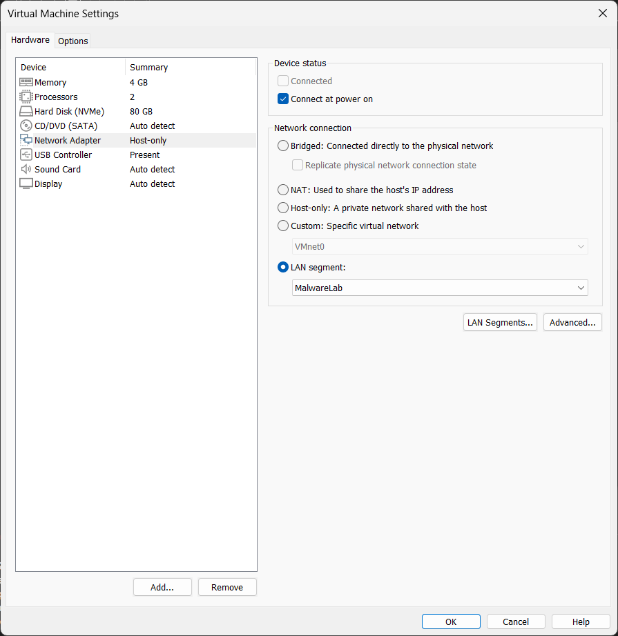
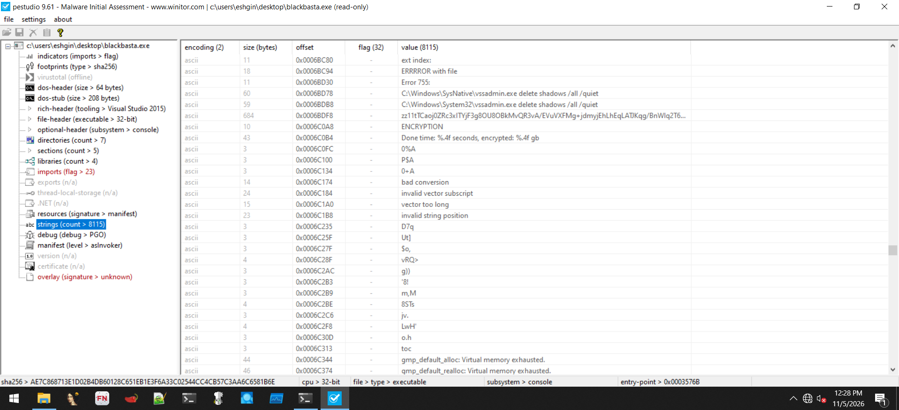
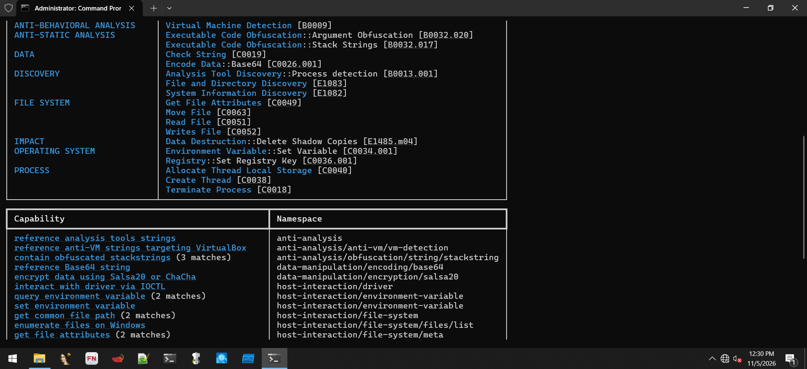
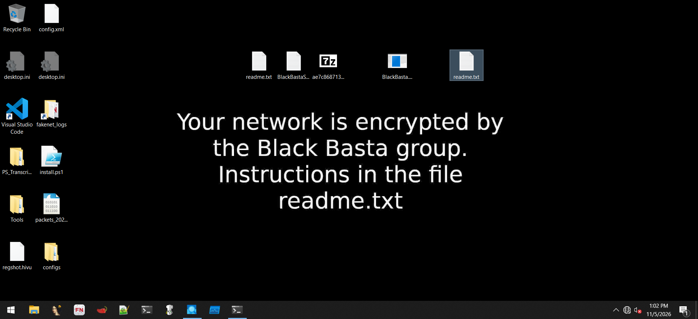
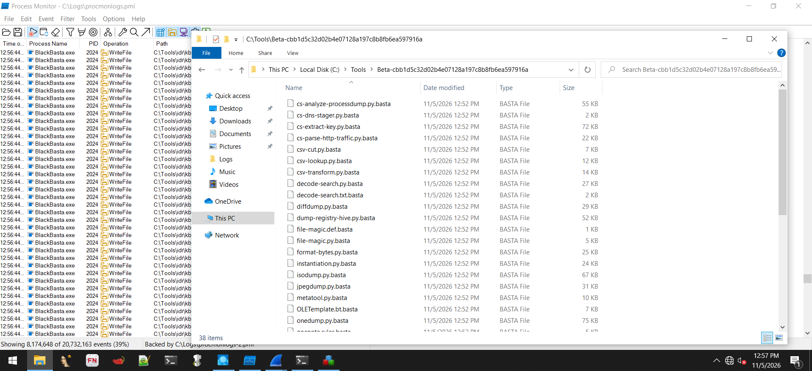

<h1 align="center">Black Basta Ransomware Analysis Lab</h1>
<p align="center"><i>An isolated, reproducible malware-analysis lab (VMware + FLARE-VM) with a full static, dynamic and threat-intelligence walkthrough of a Black Basta ransomware sample.</i></p>

<p align="center">


</p>

> **Safety notice.** This repository contains **documentation and screenshots only**. It does **not** include the malware sample, decryptors, builders or any weaponized code. All analysis was performed inside an isolated virtual machine with no route to the host or the internet. Do **not** execute live malware on a machine you care about.

---

## Table of Contents
1. [Project Overview](#1-project-overview)
2. [Sample Identification](#2-sample-identification)
3. [Executive Summary of Findings](#3-executive-summary-of-findings)
4. [Repository Structure](#4-repository-structure)
5. [Lab Architecture](#5-lab-architecture)
6. [Methodology](#6-methodology)
7. [Key Findings](#7-key-findings)
8. [MITRE ATT&CK Mapping (Summary)](#8-mitre-attck-mapping-summary)
9. [Indicators of Compromise (Summary)](#9-indicators-of-compromise-summary)
10. [Detection & Mitigation (Summary)](#10-detection--mitigation-summary)
11. [Tooling](#11-tooling)
12. [Limitations](#12-limitations)
13. [Disclaimer & License](#13-disclaimer--license)

---

## 1. Project Overview

This project documents the end-to-end process of building a safe malware-analysis environment and using it to analyze a **Black Basta** ransomware executable. It is intended as a portfolio-grade, educational reference for SOC analysts, incident responders and aspiring reverse engineers.

**Goals**

- Build an isolated Windows 10 analysis VM and harden it against accidental spread (network, clipboard, drag-and-drop, shared folders).
- Install the **FLARE-VM** toolkit and capture a clean, restorable snapshot.
- Perform **static analysis** (hashing, packer/compiler identification, PE structure, strings, capability detection).
- Enrich the sample with **threat intelligence** (VirusTotal, YARA, sandbox behavior, MITRE ATT&CK).
- Perform **dynamic analysis** (process, file system, registry and network telemetry) while the sample executes in the isolated VM.
- Translate observations into **IOCs, ATT&CK mapping and detection/mitigation guidance**.

## 2. Sample Identification

| Property | Value |
|---|---|
| File name | `BlackBasta.exe` |
| SHA-256 | `ae7c868713e1d02b4db60128c651eb1e3f6a33c02544cc4cb57c3aa6c6581b6e` |
| SHA-1 | `a996ccd0d58125bf299e89f4c03ff37afdab33fc` |
| MD5 | `53fdeb923b1890d29b8f29da77995938` |
| Imphash | `b3794746554a5701b2de3e5ea435c59b` |
| File size | 556,576 bytes (543.53 KiB) |
| File type | PE32 executable (console), Intel 80386 |
| Compiler / linker | Microsoft Visual C/C++ 19.31.30818, Microsoft Linker 14.31 (Visual Studio 2022) |
| Compile timestamp | 2022-04-16 06:29:58 UTC |
| VirusTotal | 60 / 68 engines flag the file as malicious |
| Family labels | `blackbasta`, `basta`, `bastacrypt` |

## 3. Executive Summary of Findings

- The sample is a **32-bit C++ console ransomware** with no packer detected and a moderate overall entropy of 6.62; the `.text` section holds ~71% of the file.
- Static strings and capa results show intent to **delete Volume Shadow Copies** (`vssadmin delete shadows /all /quiet`), **encrypt files** (Salsa20/ChaCha-family constants), **enumerate volumes and files**, and **detect virtual machines** (VirtualBox-oriented strings).
- A 421-byte **ransom-note template** and a **684-character Base64-like blob** are embedded in the binary.
- At runtime the sample **spawned `cmd.exe`/`conhost.exe`**, **modified the desktop wallpaper registry value**, **attempted to register a `.basta` file association**, **dropped `readme.txt` in a very large number of directories** and **renamed/encrypted files with a `.basta` extension** (including the analyst toolkit under `C:\Tools`).
- Registry baseline comparison shows **+269 keys and +1,560 values** after execution.
- The desktop wallpaper was replaced with a Black Basta message directing the victim to `readme.txt`, which contains a TOR (`.onion`) negotiation link and a unique company ID.

## 4. Repository Structure

```text
blackbasta-ransomware-analysis-lab/
├── README.md                         <- you are here
├── LICENSE
├── .gitignore
├── docs/
│   ├── 01-lab-setup.md               VM, isolation, Defender, FLARE-VM, snapshot
│   ├── 02-static-analysis.md         hashes, DIE/PEiD, pestudio, FLOSS, capa, PE-bear
│   ├── 03-threat-intelligence.md     VirusTotal, YARA, sandboxes, ATT&CK heatmap
│   ├── 04-dynamic-analysis.md        Regshot, Procmon, Process Explorer, FakeNet-NG
│   ├── 05-mitre-attack-mapping.md    technique-by-technique mapping with evidence
│   ├── 06-iocs.md                    file, registry, host and network indicators
│   ├── 07-detection-and-mitigation.md  hunting ideas, Sigma, hardening guidance
│   └── 08-lessons-learned.md         what worked, pitfalls, next steps
├── detections/
│   └── sigma/
│       ├── shadow_copy_deletion_vssadmin.yml
│       └── ransom_note_mass_creation.yml
├── iocs/
│   └── iocs.csv
└── screenshots/
    ├── 01-lab-setup/                 (15 images)
    ├── 02-static-analysis/           (18 images)
    ├── 03-dynamic-analysis/          (13 images)
    └── 04-threat-intelligence/       (5 images)
```

## 5. Lab Architecture

| Component | Configuration |
|---|---|
| Hypervisor | VMware Workstation (25H2 hardware version) |
| Guest OS | Windows 10 Pro 22H2 x64 (build 10.0.19045) |
| Resources | 2 vCPU, 4 GB RAM, 80 GB NVMe virtual disk |
| Toolkit | FLARE-VM (installed via `install.ps1`, Boxstarter + Chocolatey) |
| Network (analysis) | **LAN Segment `MalwareLab`** - no host adapter, no NAT, no internet |
| Network simulation | FakeNet-NG 3.5 + Wireshark inside the guest |
| Guest isolation | Drag-and-drop **off**, copy/paste **off**, shared folders **disabled** |
| Recovery | Snapshot **`FLARE CLEAN`** taken before the sample was introduced |
| Host-side research | Browser on the *host* used for VirusTotal lookups (never from the VM) |

<p align="center"><br><sub>The analysis VM is attached to the isolated LAN segment <code>MalwareLab</code>.</sub></p>

## 6. Methodology

```text
 Build lab ──► Harden & isolate ──► Install FLARE-VM ──► Snapshot (clean)
                                                           │
     ┌─────────────────────────────────────────────────────┘
     ▼
 Static analysis ──► Threat-intel enrichment ──► Dynamic analysis ──► Reporting
 (no execution)       (hash lookups only)         (isolated VM)       (IOCs, ATT&CK,
                                                                       detections)
```

1. **Preparation** - ISO install, resource sizing, isolation settings, Windows Update and Microsoft Defender disabled (required by the FLARE-VM installer), FLARE-VM install, clean snapshot. -> [docs/01-lab-setup.md](docs/01-lab-setup.md)
2. **Static analysis** - hashing, compiler/packer detection, PE header/section/import review, string extraction (FLOSS), capability detection (capa). -> [docs/02-static-analysis.md](docs/02-static-analysis.md)
3. **Threat intelligence** - hash-only VirusTotal lookup for detections, YARA hits, sandbox verdicts and ATT&CK tactics. -> [docs/03-threat-intelligence.md](docs/03-threat-intelligence.md)
4. **Dynamic analysis** - registry baseline (Regshot), Procmon + Process Explorer telemetry, FakeNet-NG/Wireshark network capture, execution, post-execution comparison. -> [docs/04-dynamic-analysis.md](docs/04-dynamic-analysis.md)
5. **Reporting** - ATT&CK mapping, IOCs, detections. -> docs 05-08.

## 7. Key Findings

### 7.1 Static
<p align="center"><br><sub><b>Figure 28.</b> pestudio string view showing shadow-copy deletion commands (vssadmin) and encryption-related strings.</sub></p>

<p align="center"><br><sub><b>Figure 32.</b> capa mapping: Salsa20/ChaCha encryption, VM detection, shadow-copy deletion, file enumeration and registry modification.</sub></p>


### 7.2 Dynamic
<p align="center"><br><sub><b>Figure 52.</b> Desktop wallpaper replaced by the Black Basta message after execution.</sub></p>

<p align="center"><br><sub><b>Figure 49.</b> Files in the toolkit directory renamed with the .basta extension, as captured next to the Procmon event stream.</sub></p>


## 8. MITRE ATT&CK Mapping (Summary)

| Tactic | Technique | Evidence |
|---|---|---|
| Impact | T1490 Inhibit System Recovery | `vssadmin delete shadows /all /quiet` string; capa `delete volume shadow copies` |
| Impact | T1486 Data Encrypted for Impact | `.basta` renamed files, Salsa20/ChaCha constants, ransom note |
| Defense Evasion | T1027 Obfuscated Files or Information (stack strings) | capa: 3 stackstring matches; FLOSS: 12 stack strings |
| Defense Evasion / Discovery | T1497.001 Virtualization/Sandbox Evasion: System Checks | capa: VirtualBox anti-VM strings |
| Defense Evasion | T1070.004 Indicator Removal: File Deletion | capa |
| Discovery | T1083 File and Directory Discovery | `FindFirstFileEx`/`FindNextFile`, volume enumeration |
| Discovery | T1082 System Information Discovery | capa |
| Execution | T1129 Shared Modules | capa (runtime linking via PEB) |
| Impact | T1491.001 Defacement: Internal Defacement | wallpaper registry change + wallpaper message |

Full table with evidence and confidence in [docs/05-mitre-attack-mapping.md](docs/05-mitre-attack-mapping.md).

## 9. Indicators of Compromise (Summary)

| Type | Indicator |
|---|---|
| SHA-256 | `ae7c868713e1d02b4db60128c651eb1e3f6a33c02544cc4cb57c3aa6c6581b6e` |
| MD5 | `53fdeb923b1890d29b8f29da77995938` |
| Imphash | `b3794746554a5701b2de3e5ea435c59b` |
| Ransom note | `readme.txt` (dropped in many directories) |
| Encrypted-file extension | `.basta` |
| Registry | `HKCU\Control Panel\Desktop\Wallpaper` (modified); `HKCR\.basta` / `HKCR\.basta\DefaultIcon` (creation attempted) |
| Command line | `vssadmin.exe delete shadows /all /quiet` |

See [docs/06-iocs.md](docs/06-iocs.md) and [iocs/iocs.csv](iocs/iocs.csv).

## 10. Detection & Mitigation (Summary)

- Alert on **`vssadmin delete shadows`** (and equivalents: `wmic shadowcopy delete`, `bcdedit` recovery tampering, `wbadmin delete`).
- Alert on **mass creation of identically named files** (`readme.txt`) and mass renames to an unknown extension.
- Keep **offline/immutable backups**; test restores.
- Enable **tamper protection and EDR** on production endpoints; restrict local admin.
- Segment networks to limit lateral movement; monitor TOR egress.

Details and ready-to-use Sigma rules in [docs/07-detection-and-mitigation.md](docs/07-detection-and-mitigation.md) and [`detections/sigma/`](detections/sigma/).

## 11. Tooling

| Phase | Tools |
|---|---|
| Virtualization | VMware Workstation |
| Toolkit | FLARE-VM, Boxstarter, Chocolatey |
| Hashing / identification | HashMyFiles, Detect It Easy, PEiD |
| Static analysis | pestudio, PE-bear, FLOSS, capa |
| Threat intel | VirusTotal (hash lookup from host) |
| Dynamic analysis | Regshot, Process Monitor, Process Explorer, Wireshark, FakeNet-NG |

## 12. Limitations

- No unpacking/decompilation (Ghidra/IDA/x64dbg) deep-dive of the encryption routine was performed in this lab write-up; cryptographic details are based on capa/FLOSS evidence and public reporting.
- The sample ran **without internet access**, so any C2/TOR behavior beyond the ransom note could not be observed.
- A single execution on one VM configuration; behavior may vary with privileges, command-line arguments and OS version.
- Statements marked *hypothesis* are not verified by reverse engineering.

## 13. Disclaimer & License

This work is for **educational and defensive research purposes only**. The author is not responsible for misuse. Released under the [MIT License](LICENSE).
