<h1 align="center">Black Basta Ransomware Analysis Lab</h1>

<p align="center">
  <b>Building an isolated malware-analysis laboratory and performing a full static, threat-intelligence and dynamic analysis of a Black Basta ransomware sample</b>
</p>

<p align="center">
  
  
  
  <br>
  
  
  
  
  
</p>

> [!WARNING]
> **Safety notice.** This repository contains **documentation and screenshots only**. It does **not** contain the malware sample, a builder, a decryptor, or any weaponized code. Every execution described here took place inside a disposable, network-isolated virtual machine. **Never run live malware on a system you care about.** This project is for **educational and defensive security research** only.

---

## Table of Contents

1. [Project Overview](#1-project-overview)
2. [Executive Summary](#2-executive-summary)
3. [Sample Identification](#3-sample-identification)
4. [Repository Structure](#4-repository-structure)
5. [Lab Architecture and Design Decisions](#5-lab-architecture-and-design-decisions)
6. [Phase 1 - Lab Build and Hardening](#6-phase-1---lab-build-and-hardening)
7. [Phase 2 - Static Analysis](#7-phase-2---static-analysis)
8. [Phase 3 - Threat Intelligence Enrichment](#8-phase-3---threat-intelligence-enrichment)
9. [Phase 4 - Dynamic Analysis](#9-phase-4---dynamic-analysis)
10. [Behavior Timeline](#10-behavior-timeline)
11. [MITRE ATT&CK Mapping](#11-mitre-attck-mapping)
12. [Indicators of Compromise](#12-indicators-of-compromise)
13. [Detection Engineering](#13-detection-engineering)
14. [Mitigation and Hardening Recommendations](#14-mitigation-and-hardening-recommendations)
15. [Skills Demonstrated](#15-skills-demonstrated)
16. [Limitations and Future Work](#16-limitations-and-future-work)
17. [Tool Reference](#17-tool-reference)
18. [References](#18-references)
19. [Disclaimer and License](#19-disclaimer-and-license)

---

## 1. Project Overview

Ransomware remains one of the most disruptive threats facing organizations. Understanding how a sample behaves - on disk, in memory, in the registry and on the network - is essential for building effective detections and response playbooks.

This project documents the **complete workflow** of a hands-on ransomware analysis, from an empty hypervisor to a finished technical report:

| Stage | What was done |
|---|---|
| **Lab engineering** | Built a Windows 10 VM, applied guest isolation, disabled Defender/Windows Update (required by FLARE-VM), installed the FLARE-VM toolkit, moved the VM to an isolated LAN segment and captured a clean snapshot. |
| **Static analysis** | Hashed the sample, identified compiler/packer, parsed the PE structure, extracted strings with FLOSS, detected capabilities with capa and inspected the entry point. |
| **Threat intelligence** | Looked up the hash on VirusTotal from the host: vendor detections, YARA hits, sandbox verdicts, ATT&CK matrix, family naming. |
| **Dynamic analysis** | Took a registry baseline, configured Process Monitor, simulated the network with FakeNet-NG, executed the sample, observed process/file/registry behavior, ransom note and wallpaper, and compared registry state afterwards. |
| **Reporting** | Mapped behavior to MITRE ATT&CK, extracted IOCs, and produced detection and mitigation guidance (including Sigma rules). |

**Research questions answered**

1. What is the sample, and is it packed or obfuscated?
2. What capabilities does the binary advertise before it is ever run?
3. How do the static predictions compare with real runtime behavior?
4. What artifacts can defenders use to detect and hunt this family?

---

## 2. Executive Summary

- The sample is a **32-bit C++ Windows console ransomware** compiled with **Visual Studio 2022** on **2022-04-16**. It is **not packed** (no packer signature, no abnormal section entropy).
- Static evidence (strings, imports, capa) shows the intent to **enumerate volumes and files**, **encrypt data with a Salsa20/ChaCha-family cipher**, **delete Volume Shadow Copies** with `vssadmin`, **write to the registry**, and **check for virtualization/analysis tools** (VirtualBox-oriented strings, stack strings).
- A **ransom-note template (421 bytes)** and a **684-character Base64-like blob** are embedded in the binary.
- VirusTotal shows **60 / 68** detections, a matching **Elastic Security YARA rule** (`Windows_Ransomware_BlackBasta`) and consistent family naming (`blackbasta`, `basta`, `bastacrypt`).
- At runtime, the sample started from the user desktop at **Medium integrity**, spawned `cmd.exe` and `conhost.exe`, **changed the wallpaper registry value**, **tried to register a `.basta` file association** (blocked: *ACCESS DENIED*), **dropped `readme.txt` into a very large number of directories** and **renamed encrypted files with the `.basta` extension** - including the analyst's own toolkit under `C:\Tools`.
- Procmon captured **4.8 million** events in the first run and **22.1 million** in a longer second run. CPU usage reached ~93%.
- Registry comparison: **+269 keys, +1,560 values**.
- The desktop wallpaper was replaced with *"Your network is encrypted by the Black Basta group. Instructions in the file readme.txt"*; the note directs the victim to a **TOR negotiation site** with a unique **company ID** and threatens to publish stolen data.

---

## 3. Sample Identification

| Property | Value |
|---|---|
| File name | `BlackBasta.exe` |
| **SHA-256** | `ae7c868713e1d02b4db60128c651eb1e3f6a33c02544cc4cb57c3aa6c6581b6e` |
| SHA-1 | `a996ccd0d58125bf299e89f4c03ff37afdab33fc` |
| MD5 | `53fdeb923b1890d29b8f29da77995938` |
| Imphash | `b3794746554a5701b2de3e5ea435c59b` |
| Rich PE header hash | `097c3efd91e657b69051326b4792cc68` |
| SSDEEP | `12288:M1DTMHixr1moQqUiXINDl/m1s6BQio67VlAU:AzmoQqUiXw2s6yiVxR` |
| File size | 556,576 bytes (543.53 KiB) |
| File type | PE32 executable (console), Intel 80386 (32-bit) |
| Compiler / linker | MSVC 19.31.30818 / Microsoft Linker 14.31 (Visual Studio 2022 v17.1), C++ |
| Compile timestamp | 2022-04-16 06:29:58 UTC |
| First seen in the wild | 2022-05-03 (VirusTotal) |
| Entry point | RVA `0x3576B` (file offset `0x34B6B`), section `.text` |
| Manifest | `asInvoker` (does not request elevation) |
| Overlay | 32 bytes at offset `0x87E00` (hex string) |
| VirusTotal | **60 / 68** malicious |

---

## 4. Repository Structure

```text
blackbasta-ransomware-analysis-lab/
├── README.md                          <- full report (this file)
├── LICENSE
├── .gitignore                         <- blocks malware/log artifacts from being committed
├── docs/                              <- the same analysis split into focused documents
│   ├── 01-lab-setup.md
│   ├── 02-static-analysis.md
│   ├── 03-threat-intelligence.md
│   ├── 04-dynamic-analysis.md
│   ├── 05-mitre-attack-mapping.md
│   ├── 06-iocs.md
│   ├── 07-detection-and-mitigation.md
│   └── 08-lessons-learned.md
├── detections/
│   └── sigma/
│       ├── shadow_copy_deletion_vssadmin.yml
│       └── ransom_note_mass_creation.yml
├── iocs/
│   └── iocs.csv
└── screenshots/
    ├── 01-lab-setup/                  (15 images)
    ├── 02-static-analysis/            (18 images)
    ├── 03-dynamic-analysis/           (13 images)
    └── 04-threat-intelligence/        (5 images)
```

---

## 5. Lab Architecture and Design Decisions

```text
 ┌──────────────────────────── Physical host ────────────────────────────┐
 │  VMware Workstation                                                    │
 │  ┌───────────────────────────────────────────────────────────────┐    │
 │  │  Windows 10 22H2 x64  +  FLARE-VM  (2 vCPU / 4 GB / 80 GB)     │    │
 │  │  FakeNet-NG + Wireshark  (simulated internet, PCAP capture)    │    │
 │  │  Procmon / Process Explorer / Regshot / pestudio / capa / ...  │    │
 │  └───────────────┬───────────────────────────────────────────────┘    │
 │                  │  LAN Segment "MalwareLab"  (no NAT, no bridge)     │
 │                  X  <- no route to host, LAN or internet               │
 │                                                                        │
 │  Host browser  ->  VirusTotal (hash lookup only; sample never uploaded)│
 └────────────────────────────────────────────────────────────────────────┘
```

| Decision | Rationale |
|---|---|
| **LAN Segment** instead of NAT / bridged / host-only | A LAN segment is a private L2 network with no host adapter - the strongest isolation VMware Workstation offers without a separate air-gapped machine. |
| Clipboard, drag-and-drop and shared folders **disabled** | Removes the common guest-to-host data paths. |
| **Hash-only** VirusTotal lookup from the **host** | Avoids tipping off the adversary by uploading, keeps the VM offline. |
| **FakeNet-NG** inside the guest | Gives the sample a simulated network so network behavior can still be observed and captured. |
| **Snapshot `FLARE CLEAN`** | Every detonation starts from a known-good state. |
| Defender / Windows Update disabled | Required for FLARE-VM installation and to keep the VM state stable during analysis. **Only acceptable in a disposable VM.** |

| Component | Configuration |
|---|---|
| Hypervisor | VMware Workstation (25H2 hardware version) |
| Guest OS | Windows 10 Pro 22H2 x64 (build 10.0.19045) |
| Resources | 2 vCPU, 4 GB RAM, 80 GB NVMe virtual disk |
| Toolkit | FLARE-VM (Boxstarter + Chocolatey) |
| Analysis network | LAN Segment `MalwareLab` |
| Recovery | Snapshot `FLARE CLEAN` |

---

## 6. Phase 1 - Lab Build and Hardening

### 6.1 Virtual machine creation

A new VM was created from a **Windows 10 22H2 x64 ISO**. VMware recognized the guest OS and used *Easy Install*. The disk (80 GB) exceeds the 60 GB minimum recommended for FLARE-VM.

<p align="center">
  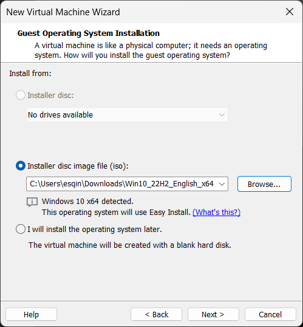
  <br><sub><b>Figure 1.</b> New Virtual Machine Wizard: Windows 10 22H2 x64 installer ISO selected; VMware detects "Windows 10 x64" and uses Easy Install.</sub>
</p>

<p align="center">
  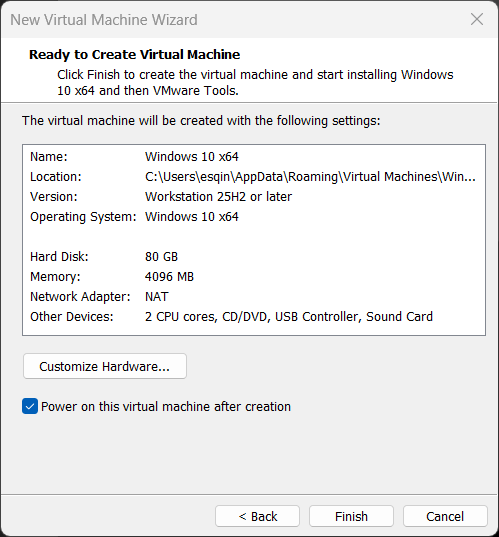
  <br><sub><b>Figure 2.</b> Ready to Create Virtual Machine: Workstation 25H2, 80 GB disk, 4096 MB RAM, NAT adapter (changed later), 2 CPU cores.</sub>
</p>

<p align="center">
  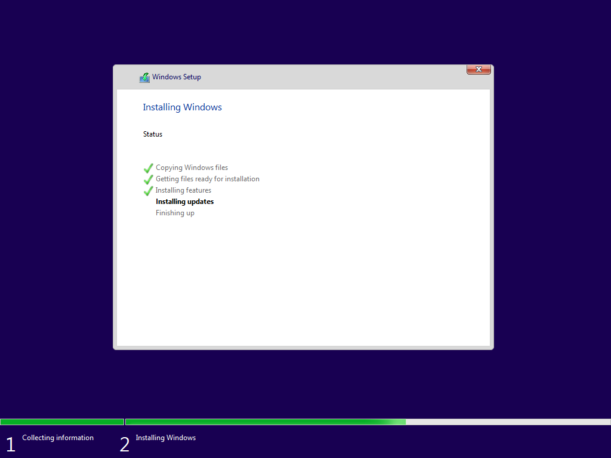
  <br><sub><b>Figure 3.</b> Windows Setup: Copying files, Getting files ready, Installing features done - Installing updates in progress.</sub>
</p>

<p align="center">
  
  <br><sub><b>Figure 4.</b> First logon of the analysis VM (profile name FLARE-VM).</sub>
</p>


### 6.2 Guest isolation

Under *VM Settings -> Options -> Guest Isolation*, **drag-and-drop** and **copy-paste** were disabled; **Shared Folders** were disabled; sensor sharing was off.

<p align="center">
  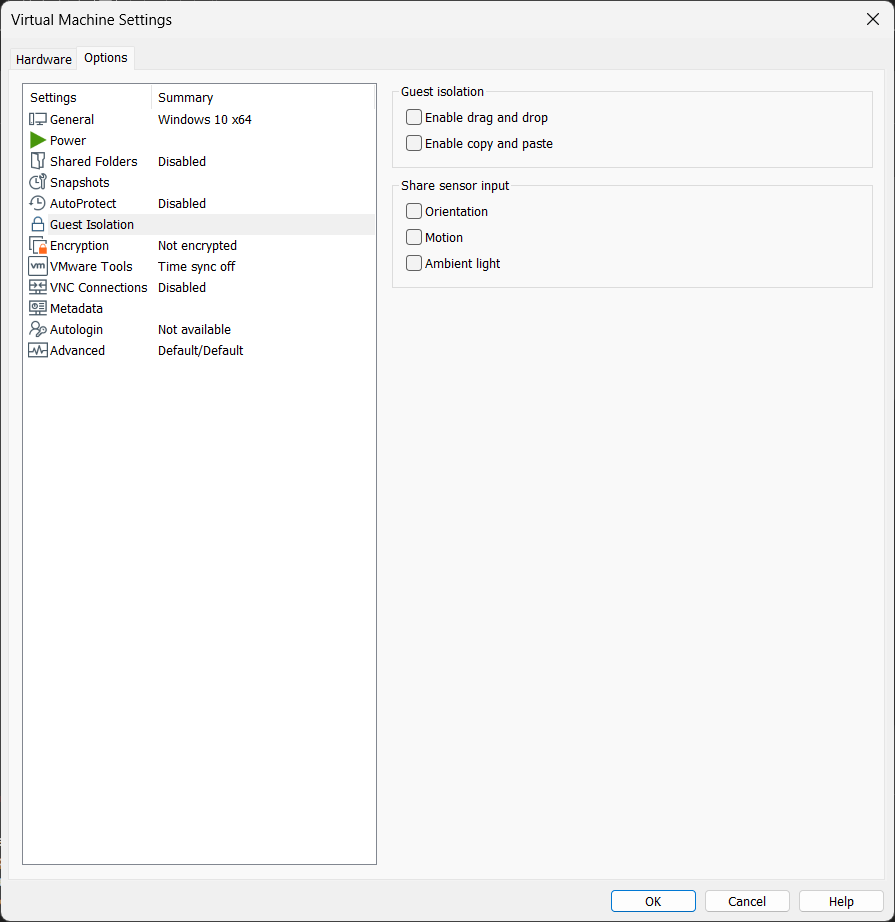
  <br><sub><b>Figure 5.</b> Virtual Machine Settings: Guest Isolation (drag/drop and copy/paste unchecked), Shared Folders Disabled, Snapshots, AutoProtect disabled.</sub>
</p>


### 6.3 Disabling Windows Update and Microsoft Defender

FLARE-VM refuses to install while Defender/Tamper Protection are active, and automatic updates would alter the VM during analysis. In this **throwaway** VM:

1. The **Windows Update (`wuauserv`) service** was set to *Disabled* and stopped.
2. Defender **real-time protection, cloud-delivered protection, automatic sample submission and Tamper Protection** were turned off.
3. The Group Policy *"Turn off Microsoft Defender Antivirus"* was set to **Enabled** so Defender stays off after reboot.

<p align="center">
  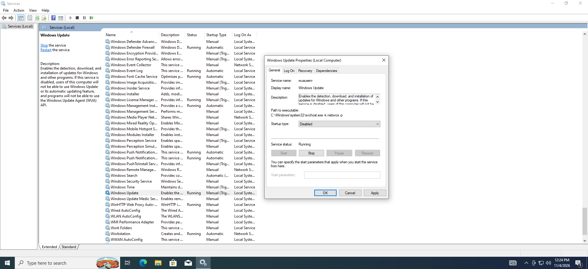
  <br><sub><b>Figure 6.</b> Windows Update service properties: startup type Disabled while the service is still running.</sub>
</p>

<p align="center">
  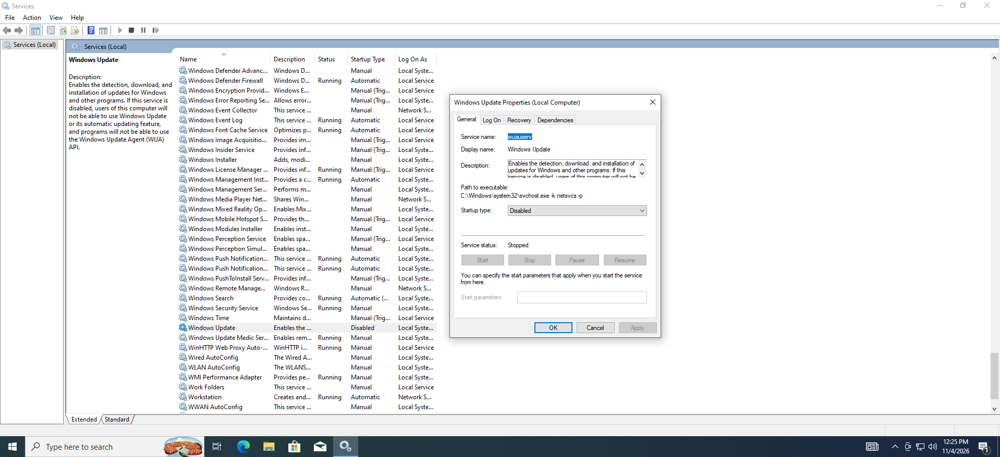
  <br><sub><b>Figure 7.</b> Windows Update service after clicking Stop: status Stopped, startup type Disabled.</sub>
</p>

<p align="center">
  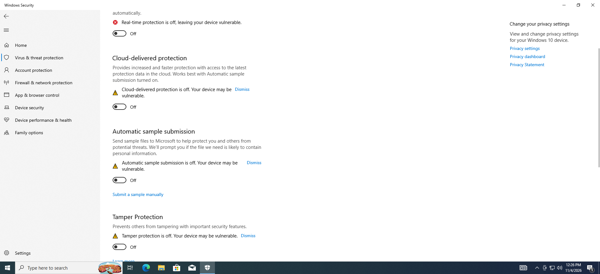
  <br><sub><b>Figure 8.</b> Windows Security: real-time protection, cloud-delivered protection, automatic sample submission and Tamper Protection all Off.</sub>
</p>

<p align="center">
  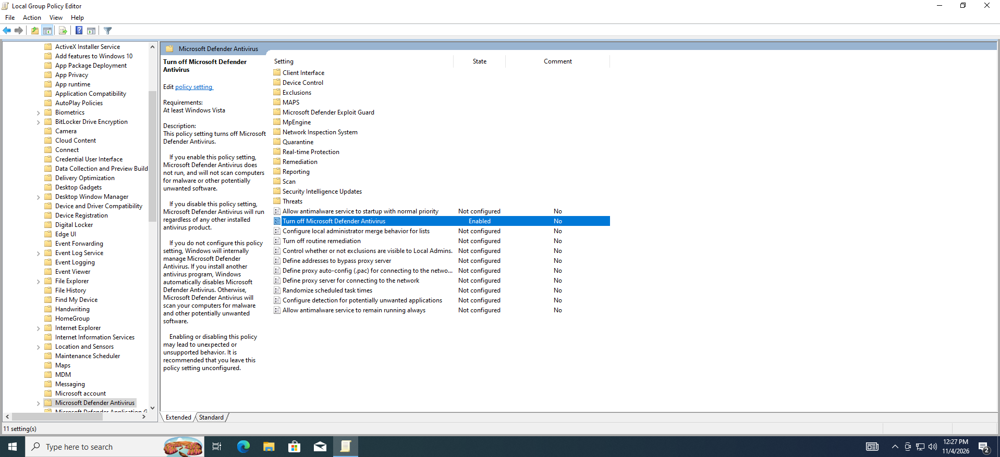
  <br><sub><b>Figure 9.</b> Local Group Policy Editor: "Turn off Microsoft Defender Antivirus" = Enabled.</sub>
</p>


> [!CAUTION]
> These changes make a machine highly vulnerable. They are only acceptable because the VM is disposable and network-isolated.

### 6.4 FLARE-VM installation

FLARE-VM was installed with Mandiant's `install.ps1` from an elevated PowerShell prompt (script downloaded, unblocked, execution policy set to *Unrestricted*). The installer's pre-checks validate PowerShell version, administrator rights, execution policy, Windows version, VM environment, user name, disk space, internet and Defender state.

<p align="center">
  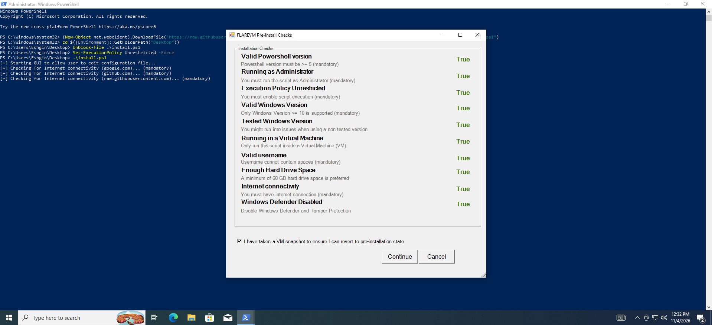
  <br><sub><b>Figure 10.</b> FLARE-VM Pre-Install Checks: all checks True (VM detected, Defender disabled) and the snapshot confirmation tick-box.</sub>
</p>


The installer bootstrapped **Boxstarter** and **Chocolatey**, then asked where to install tools:

| Variable | Value |
|---|---|
| `%VM_COMMON_DIR%` | `%ProgramData%\_VM` |
| `%TOOL_LIST_DIR%` | `%UserProfile%\Desktop\Tools` |
| `%RAW_TOOLS_DIR%` | `%SystemDrive%\Tools` |

<p align="center">
  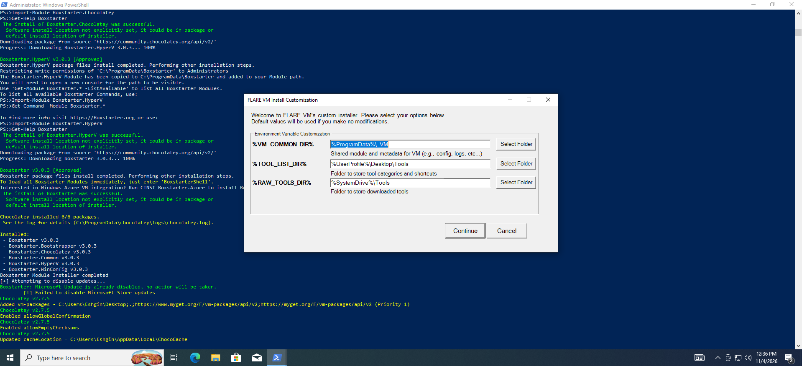
  <br><sub><b>Figure 11.</b> Boxstarter/Chocolatey modules installed successfully and the FLARE VM install customization dialog (tool directories).</sub>
</p>


The recommended package set was kept (x64dbg with plugins, WinDbg, Ghidra, Cutter, Binary Ninja, IDA Free, IDR and more), with `dotnet3.5` and `vcredist-all` added.

<p align="center">
  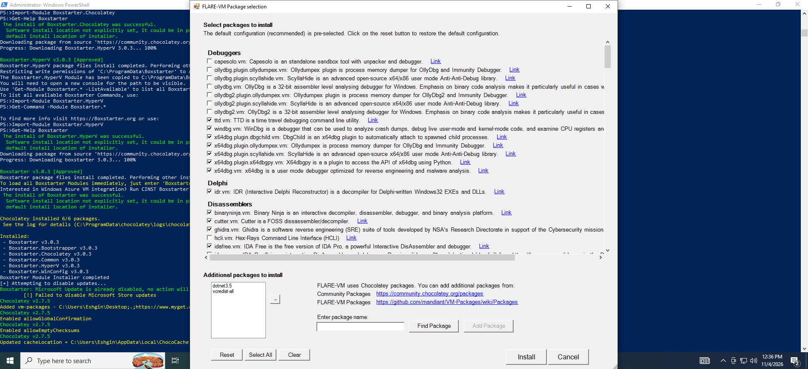
  <br><sub><b>Figure 12.</b> FLARE-VM package selection: debuggers, Delphi, disassemblers; additional packages dotnet3.5 and vcredist-all.</sub>
</p>

<p align="center">
  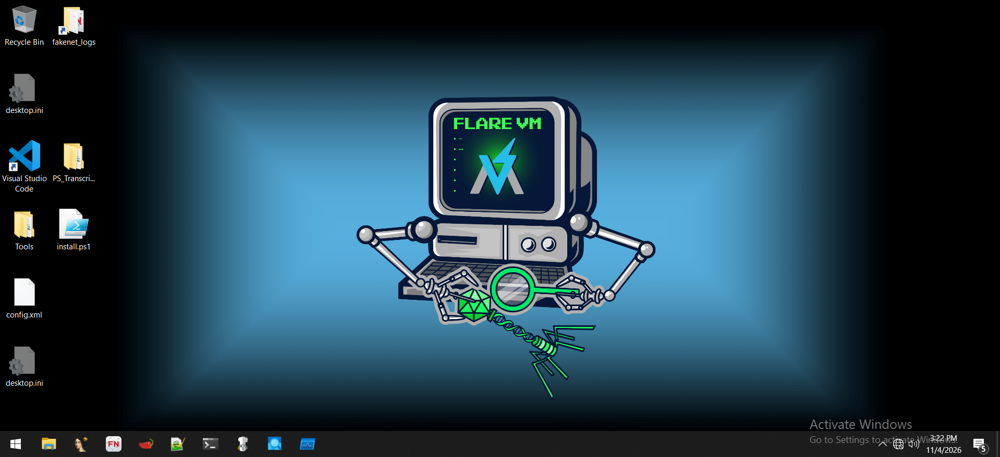
  <br><sub><b>Figure 13.</b> FLARE-VM desktop after installation: Tools folder, fakenet_logs shortcut, VS Code, install artifacts.</sub>
</p>


> The Boxstarter log showed a non-fatal warning (*"Failed to disable Microsoft Store updates"*), which did not affect the analysis.

### 6.5 Network isolation

Once the toolkit was installed and no more downloads were needed, the VM network adapter was moved from NAT to the **LAN Segment `MalwareLab`**.

<p align="center">
  
  <br><sub><b>Figure 14.</b> Network Adapter set to LAN segment "MalwareLab" with "Connect at power on" enabled.</sub>
</p>


Inside the guest, Windows then reports *"Unidentified network - No Internet access"* (visible in the capa screenshots), confirming isolation.

### 6.6 Clean snapshot

<p align="center">
  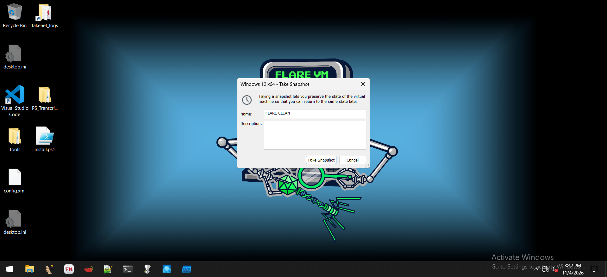
  <br><sub><b>Figure 15.</b> Take Snapshot: "FLARE CLEAN" - the known-good state used before each detonation.</sub>
</p>


### 6.7 Pre-execution checklist

- [x] Clipboard, drag-and-drop and shared folders disabled
- [x] Adapter on isolated LAN segment (no NAT, bridged or host-only)
- [x] Windows Defender, Tamper Protection and Windows Update disabled
- [x] FLARE-VM installed and verified
- [x] `FLARE CLEAN` snapshot taken
- [x] Sample kept as an archive until analysis began

---

## 7. Phase 2 - Static Analysis

*Static analysis inspects the file without executing it.* All tools ran inside FLARE-VM.

### 7.1 Sample staging

The sample arrived as a 7-Zip archive named by its SHA-256 and was extracted to the desktop as `BlackBasta.exe`.

<p align="center">
  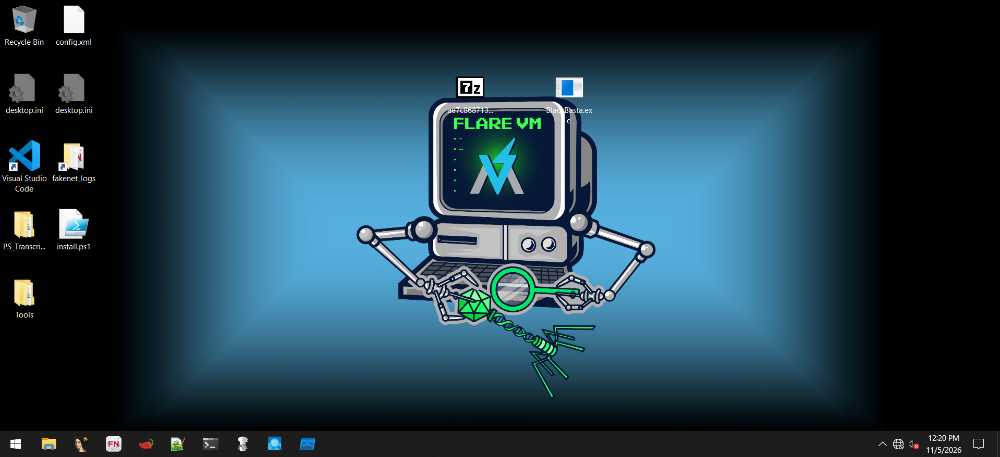
  <br><sub><b>Figure 16.</b> FLARE-VM desktop: the archive (named by SHA-256) and the extracted BlackBasta.exe.</sub>
</p>


### 7.2 Hashing

HashMyFiles verified the cryptographic hashes and size.

<p align="center">
  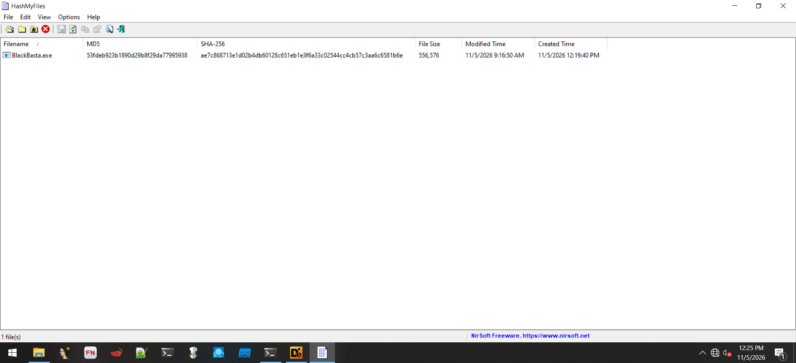
  <br><sub><b>Figure 19.</b> HashMyFiles: MD5, SHA-256 and size (556,576 bytes) of BlackBasta.exe.</sub>
</p>


| Algorithm | Value |
|---|---|
| MD5 | `53fdeb923b1890d29b8f29da77995938` |
| SHA-256 | `ae7c868713e1d02b4db60128c651eb1e3f6a33c02544cc4cb57c3aa6c6581b6e` |

### 7.3 File type, compiler and packer identification

**Detect It Easy** identifies a **PE32, 32-bit, console** executable linked with **Microsoft Linker 14.31**, compiled with **MSVC 19.31.30818 (C++)** using **Visual Studio 2022 v17.1**, and a 32-byte plain-text **overlay**.

<p align="center">
  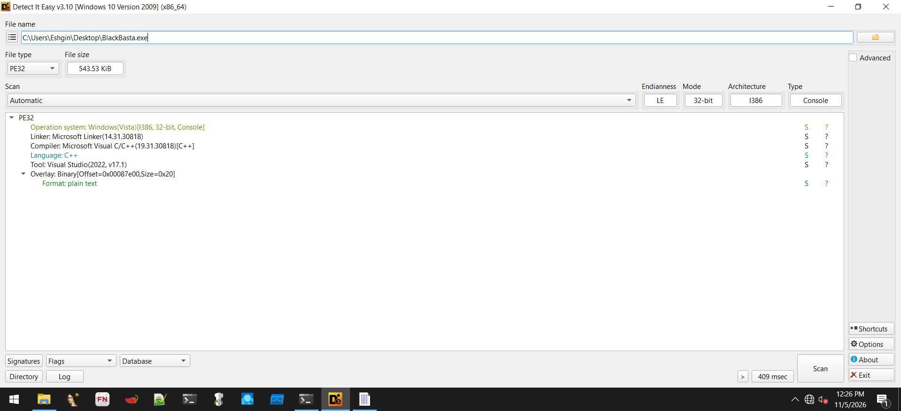
  <br><sub><b>Figure 20.</b> Detect It Easy v3.10: PE32 / MSVC C++ / Visual Studio 2022 and a 32-byte overlay at 0x00087E00.</sub>
</p>


**PEiD** agrees: entry point `0x0003576B` in `.text`, linker 14.31, signature "Microsoft Visual C++ 8 [Overlay]".

<p align="center">
  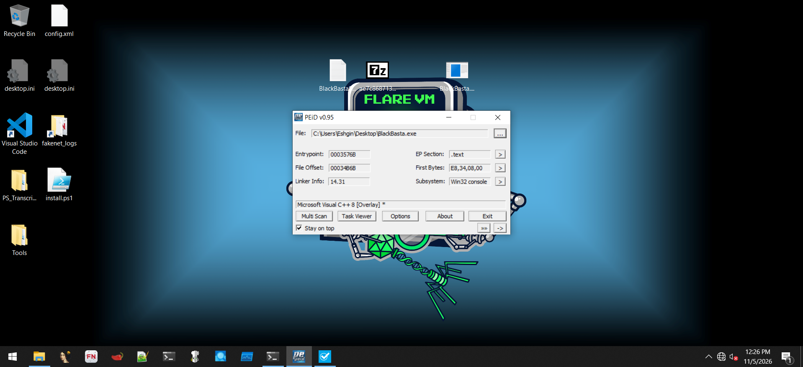
  <br><sub><b>Figure 21.</b> PEiD v0.95: entry point, file offset, EP section, first bytes E8 34 08 00 and compiler signature.</sub>
</p>


> **Result:** no known packer. Unpacked code simplifies both static analysis and detection engineering.

### 7.4 PE structure with pestudio

<p align="center">
  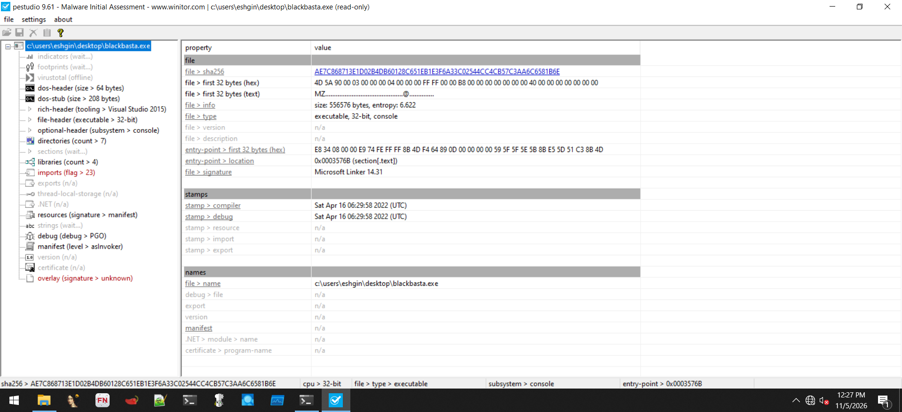
  <br><sub><b>Figure 22.</b> pestudio overview: SHA-256, entropy 6.622, compile stamp 2022-04-16 06:29:58 UTC, entry point 0x3576B, manifest asInvoker.</sub>
</p>


| Attribute | Value |
|---|---|
| Architecture | 32-bit (i386), console subsystem |
| Whole-file entropy | 6.622 |
| Compiler and debug stamp | Sat Apr 16 06:29:58 2022 (UTC) |
| Manifest level | `asInvoker` |
| Imports / flagged | 120 / 23 (4 libraries) |
| Strings | 8,115 |
| Resources | 1 (381 bytes) |

<p align="center">
  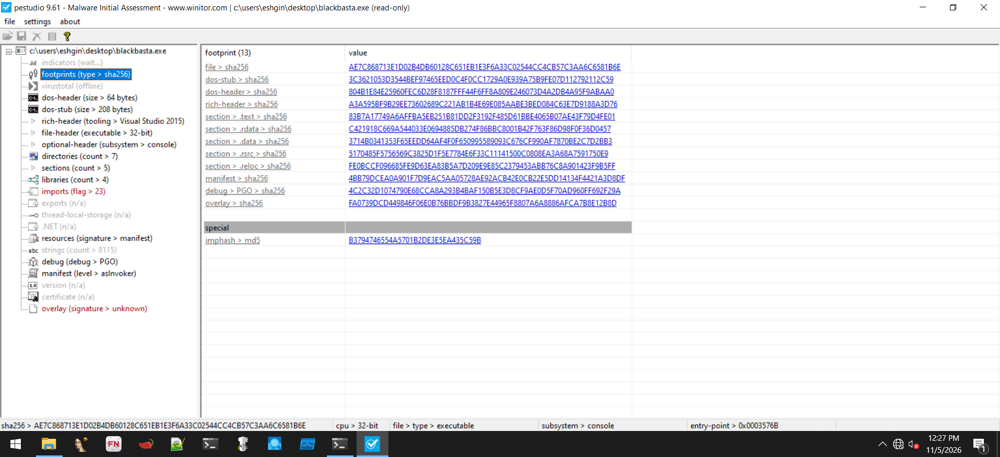
  <br><sub><b>Figure 23.</b> pestudio footprints: SHA-256 of file, DOS stub/header, Rich header, every section, manifest, debug and overlay, plus the imphash.</sub>
</p>

<p align="center">
  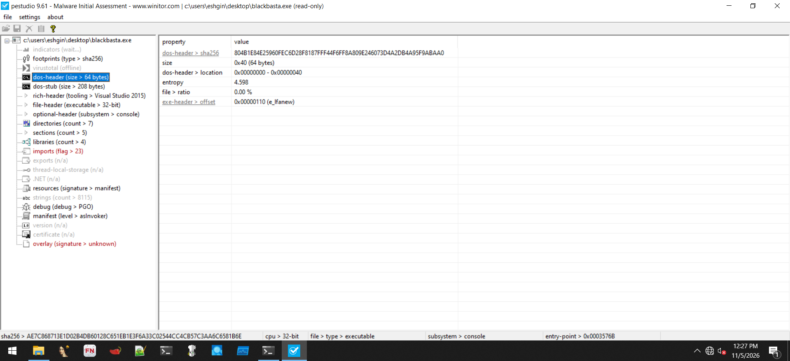
  <br><sub><b>Figure 24.</b> DOS header: 64 bytes, entropy 4.598, e_lfanew at 0x110.</sub>
</p>


#### Sections

| Section | Raw size | Share | Entropy | Characteristics |
|---|---|---|---|---|
| `.text` | 395,264 B | 71.0% | 6.594 | executable |
| `.rdata` | 131,584 B | 23.6% | 5.750 | read-only; import/debug/load-config/TLS directories |
| `.data` | 9,216 B | 1.7% | 3.900 | writable |
| `.rsrc` | 512 B | 0.1% | 4.718 | manifest |
| `.reloc` | 18,944 B | 3.4% | 6.560 | relocations |

<p align="center">
  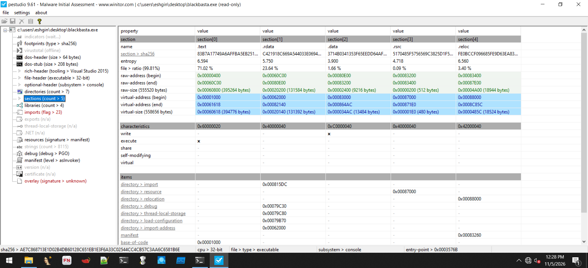
  <br><sub><b>Figure 25.</b> Section table: names, entropy, raw and virtual addresses, characteristics; only .text is executable and only .data is writable.</sub>
</p>


No section approaches the entropy range typical of packed/encrypted data (> 7) and no section is both writable and executable, which supports the **unpacked** conclusion.

#### Imports

pestudio flags APIs related to volume and file enumeration (`FindFirstVolumeW`, `FindNextVolumeW`, `GetVolumePathNamesForVolumeNameW`, `FindFirstFileExW`, `FindNextFileW`), renaming (`MoveFileW`), process and environment handling (`GetCurrentProcessId`, `SetEnvironmentVariableW`, `CreateProcessW`, `TerminateProcess`) and device I/O (`DeviceIoControl`).

<p align="center">
  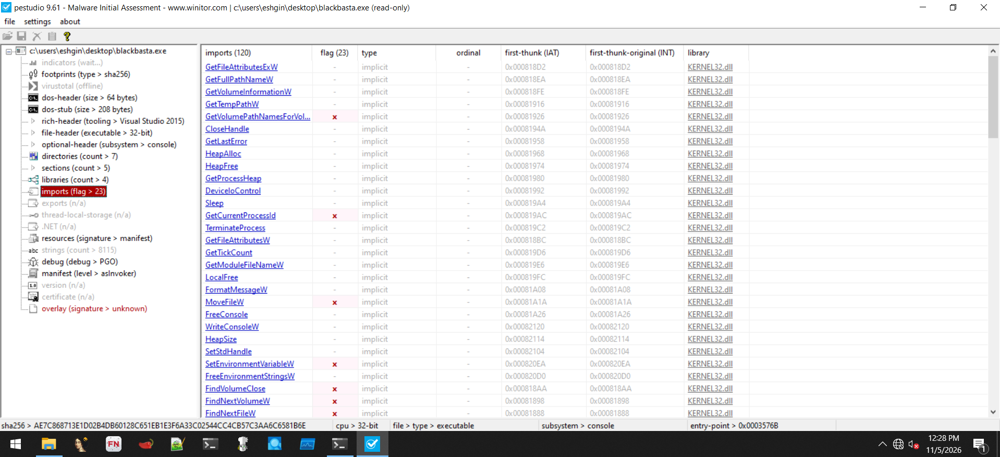
  <br><sub><b>Figure 26.</b> pestudio imports: 120 imports, 23 flagged (volume enumeration, MoveFileW, environment variables, process id).</sub>
</p>


### 7.5 String analysis

Two methods were combined: pestudio (8,115 strings) and **FLOSS v3.1.1**, which also recovers **stack, tight and decoded strings** that plain `strings` would miss.

<p align="center">
  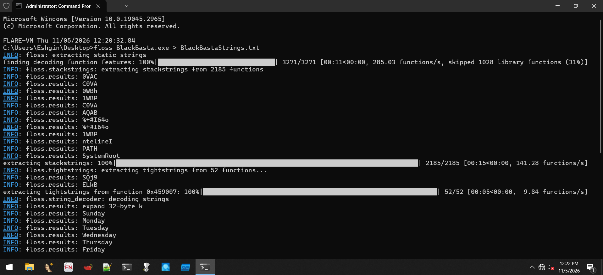
  <br><sub><b>Figure 17.</b> FLOSS running from an elevated command prompt: static, stack, tight and decoded string extraction.</sub>
</p>

<p align="center">
  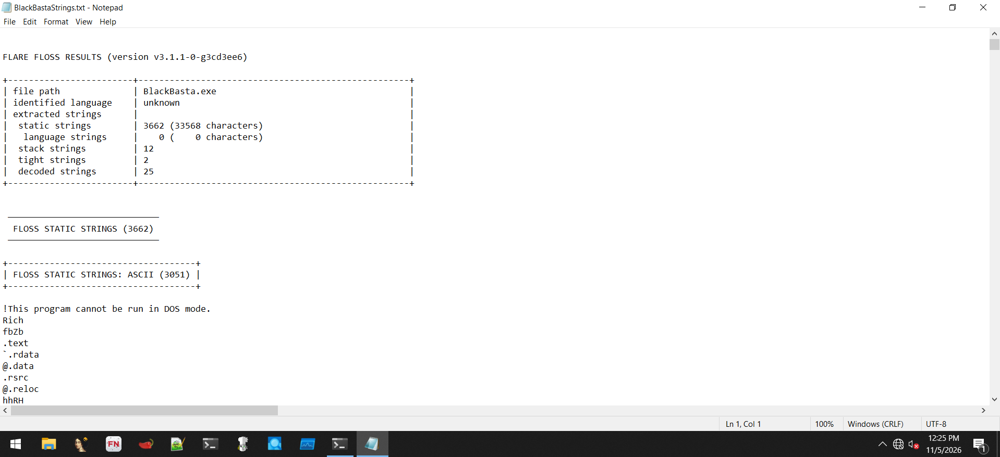
  <br><sub><b>Figure 18.</b> FLOSS result: 3,662 static strings (33,568 chars), 12 stack strings, 2 tight strings, 25 decoded strings.</sub>
</p>


#### High-value strings

| String / artifact | Interpretation |
|---|---|
| `C:\Windows\SysNative\vssadmin.exe delete shadows /all /quiet` | Deletes **all Volume Shadow Copies**; `SysNative` is the path a 32-bit process uses to reach the 64-bit `System32` |
| `C:\Windows\System32\vssadmin.exe delete shadows /all /quiet` | Fallback path |
| `ENCRYPTION` | Status label |
| `Done time: %.4f seconds, encrypted: %.4f gb` | Completion summary printed by the console binary |
| `Your data are stolen and encrypted ...` (421 B) | Ransom-note template |
| 684-character Base64-like blob | *Hypothesis:* embedded key material (e.g. a public key) - **not verified** |
| `gmp_default_alloc: Virtual memory exhausted.` | GMP big-number library statically linked (typical for RSA code) |
| `expand 32-byte k` | Constant used by Salsa20/ChaCha stream ciphers |
| `ERRRROR with file`, `Error 755:` | Error messages |

<p align="center">
  
  <br><sub><b>Figure 27.</b> pestudio strings: vssadmin delete shadows (SysNative and System32), ENCRYPTION, completion message and the long Base64-like blob.</sub>
</p>

<p align="center">
  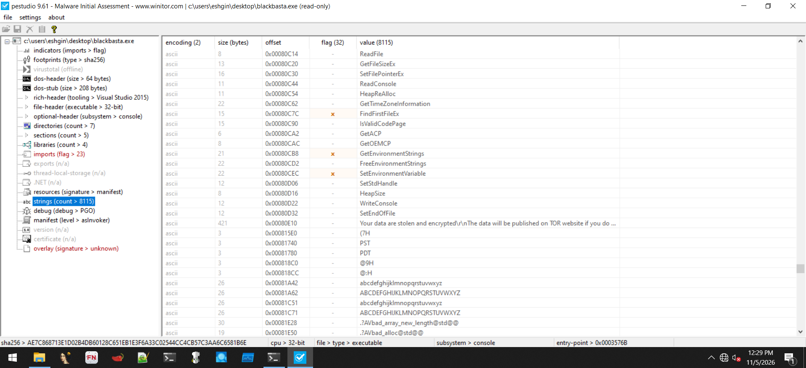
  <br><sub><b>Figure 28.</b> pestudio strings in .rdata: the 421-byte ransom-note template ("Your data are stolen and encrypted ... published on TOR website ...").</sub>
</p>

<p align="center">
  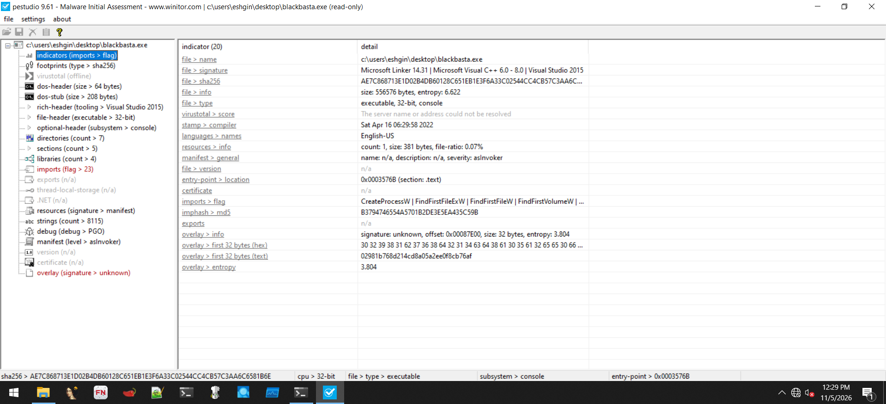
  <br><sub><b>Figure 29.</b> pestudio indicators: signature, compile stamp, 1 resource, manifest asInvoker, flagged imports, imphash and overlay information.</sub>
</p>


The 32-byte overlay (entropy 3.804) reads as the hex string `02981b768d214cd8a05a2ee0f8cb76af`.

### 7.6 Capability detection with capa

capa (FLARE) maps the binary to ATT&CK, the Malware Behavior Catalog (MBC) and concrete capabilities - a fast way to answer *"what can this do?"* without a disassembler.

<p align="center">
  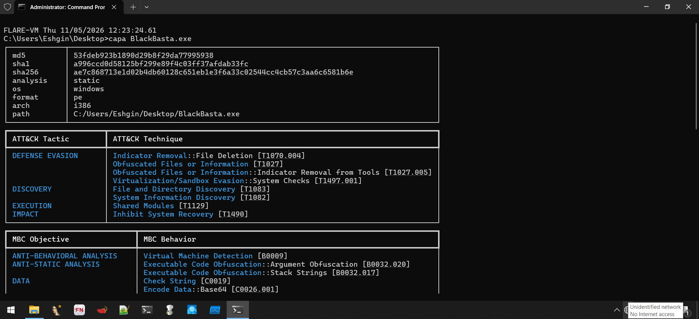
  <br><sub><b>Figure 30.</b> capa: sample hashes and the ATT&CK tactic/technique table (Defense Evasion, Discovery, Execution, Impact).</sub>
</p>

<p align="center">
  
  <br><sub><b>Figure 31.</b> capa: MBC behaviors and the start of the capability table.</sub>
</p>

<p align="center">
  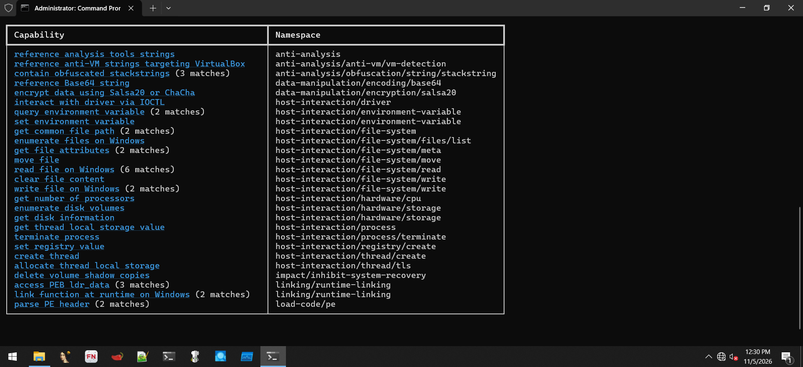
  <br><sub><b>Figure 32.</b> capa: complete capability table - file enumeration, read/write/move, volume enumeration, registry, threads, delete volume shadow copies, PE parsing.</sub>
</p>


| capa ATT&CK technique | ID |
|---|---|
| Indicator Removal: File Deletion | T1070.004 |
| Obfuscated Files or Information | T1027 |
| Obfuscated Files: Indicator Removal from Tools | T1027.005 |
| Virtualization/Sandbox Evasion: System Checks | T1497.001 |
| File and Directory Discovery | T1083 |
| System Information Discovery | T1082 |
| Shared Modules | T1129 |
| Inhibit System Recovery | T1490 |

**Notable capabilities**

- **Anti-analysis:** references analysis-tool strings, anti-VM strings targeting VirtualBox, **3 obfuscated stack strings**.
- **Cryptography:** Base64 string, **encrypt data using Salsa20 or ChaCha**.
- **Host interaction:** driver communication via **IOCTL**, environment-variable query/set, **enumerate files**, **enumerate disk volumes**, get disk information, get number of processors, move/read/write/clear file, terminate process, **set registry value**, create thread, thread-local storage.
- **Impact:** **delete volume shadow copies**.
- **Loader behavior:** access PEB `ldr_data`, link functions at runtime, parse PE header.

### 7.7 Entry-point inspection with PE-bear

<p align="center">
  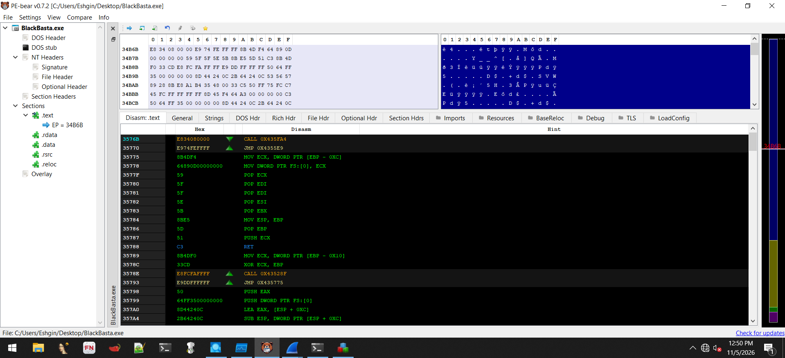
  <br><sub><b>Figure 42.</b> PE-bear: entry point (EP = 34B6B) in .text; the disassembly shows the MSVC CRT start-up stub.</sub>
</p>


The entry code is the standard MSVC runtime start-up stub, consistent with an unpacked, compiler-generated binary.

### 7.8 Static analysis conclusions

1. **Unpacked 32-bit C++ ransomware**, Visual Studio 2022, compiled April 2022.
2. Advertised capabilities: **volume/file enumeration, Salsa20/ChaCha-family encryption, file renaming, shadow-copy deletion, registry writes, multi-threading**.
3. **Light anti-analysis:** stack strings and VirtualBox/analysis-tool string references.
4. Predictions to validate dynamically: ransom note, `.basta`-style file changes, shadow-copy deletion, registry modification.

---

## 8. Phase 3 - Threat Intelligence Enrichment

Only the **hash** was submitted to VirusTotal, from the **host** browser. The VM remained offline (pestudio's own VirusTotal check reads *offline*).

### 8.1 Detections and sandbox verdicts

<p align="center">
  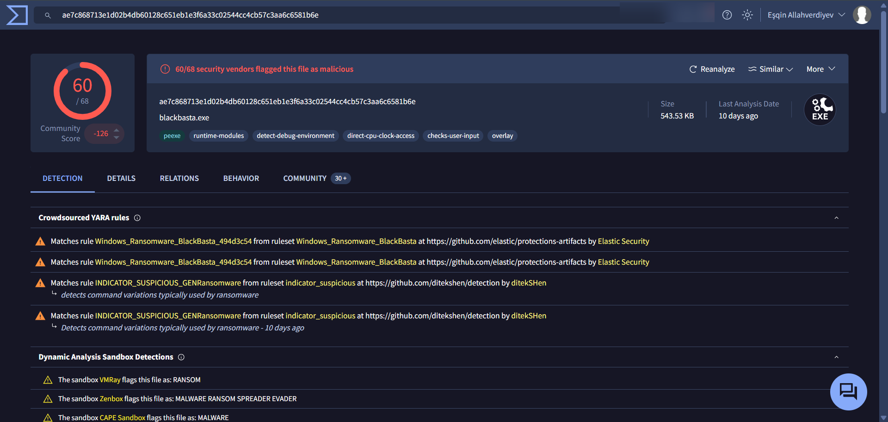
  <br><sub><b>Figure 34.</b> VirusTotal: 60/68 vendors flag the file; Elastic YARA rule Windows_Ransomware_BlackBasta matches; VMRay, Zenbox and CAPE classify it as ransomware/malware.</sub>
</p>


| Item | Value |
|---|---|
| Detections | **60 / 68** |
| Community score | -126 |
| Behavior tags | peexe, runtime-modules, detect-debug-environment, direct-cpu-clock-access, checks-user-input, overlay |
| Crowdsourced YARA | `Windows_Ransomware_BlackBasta_494d3c54` (Elastic Security); `INDICATOR_SUSPICIOUS_GENRansomware` (ditekSHen) |
| Sandboxes | VMRay: RANSOM; Zenbox: MALWARE RANSOM SPREADER EVADER; CAPE: MALWARE |

### 8.2 File metadata and history

<p align="center">
  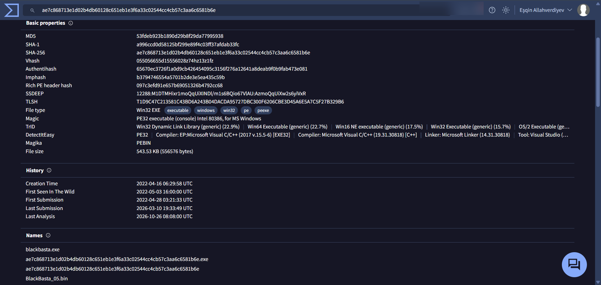
  <br><sub><b>Figure 35.</b> VirusTotal Details: MD5/SHA-1/SHA-256, Vhash, Authentihash, Imphash, Rich PE header hash, SSDEEP, TLSH, file type, history and names.</sub>
</p>


| Field | Value |
|---|---|
| Creation time | 2022-04-16 06:29:58 UTC (matches pestudio) |
| First submission | 2022-04-28 03:21:33 UTC |
| First seen in the wild | 2022-05-03 16:00:00 UTC |
| Imphash | `b3794746554a5701b2de3e5ea435c59b` (matches pestudio) |
| Known names | `blackbasta.exe`, `BlackBasta_05.bin`, SHA-256-named files |

The matching compile stamp and imphash confirm the analyzed file is the widely circulated sample.

### 8.3 Relations

<p align="center">
  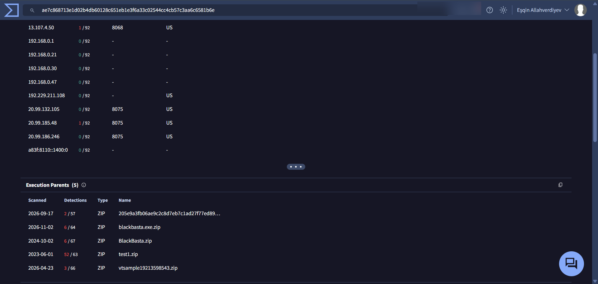
  <br><sub><b>Figure 36.</b> VirusTotal Relations: IPs contacted in sandboxes and five execution-parent ZIP archives.</sub>
</p>


The contacted IPs (e.g. `13.107.4.50`, `20.99.x.x`, `192.229.211.108`, private `192.168.0.x`) are typical **sandbox background traffic** and were **not** treated as Black Basta infrastructure.

### 8.4 ATT&CK view from the sandbox

<p align="center">
  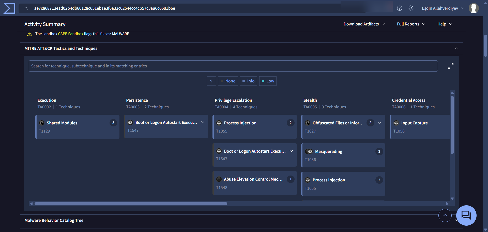
  <br><sub><b>Figure 37.</b> VirusTotal Activity Summary: ATT&CK matrix (Shared Modules, Boot/Logon Autostart, Process Injection, Obfuscated Files, Masquerading, Abuse Elevation Control, Input Capture).</sub>
</p>


Sandbox techniques come partly from generic heuristics. Only techniques with direct evidence from this lab are carried into [Section 11](#11-mitre-attck-mapping) with high or medium confidence.

### 8.5 Vendor naming

<p align="center">
  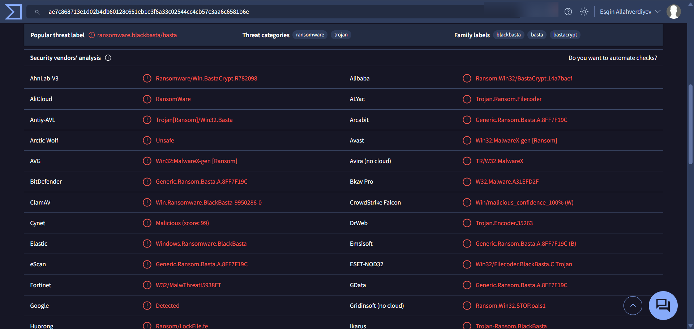
  <br><sub><b>Figure 38.</b> Security vendor analysis: threat label ransomware.blackbasta/basta; family labels blackbasta, basta, bastacrypt.</sub>
</p>


Consistent naming across vendors (Elastic `Windows.Ransomware.BlackBasta`, ClamAV `Win.Ransomware.BlackBasta`, ESET `Win32/Filecoder.BlackBasta.C`, Ikarus `Trojan-Ransom.BlackBasta`, AhnLab `Ransomware/Win.BastaCrypt`) supports **malware-family** attribution (not threat-actor attribution).

---

## 9. Phase 4 - Dynamic Analysis

> [!IMPORTANT]
> Execution happened **only inside the isolated FLARE-VM** (LAN segment, no internet). All telemetry tools were started **before** the sample.

| Telemetry | Tool |
|---|---|
| Registry delta | Regshot 1.9.1 x64 |
| Process / file / registry / network events | Process Monitor |
| Process tree, CPU/memory | Process Explorer |
| Simulated services and PCAP | FakeNet-NG 3.5, Wireshark |

### 9.1 Registry baseline (Regshot 1st shot)

<p align="center">
  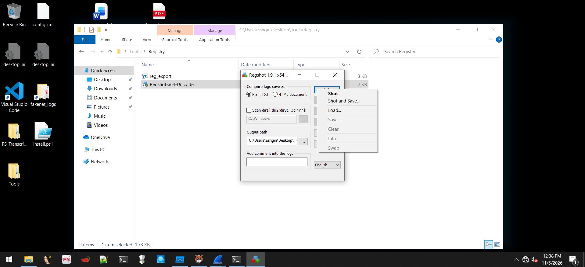
  <br><sub><b>Figure 33.</b> Regshot launched from Tools\\Registry; the 1st shot menu (Shot / Shot and Save / Load).</sub>
</p>

<p align="center">
  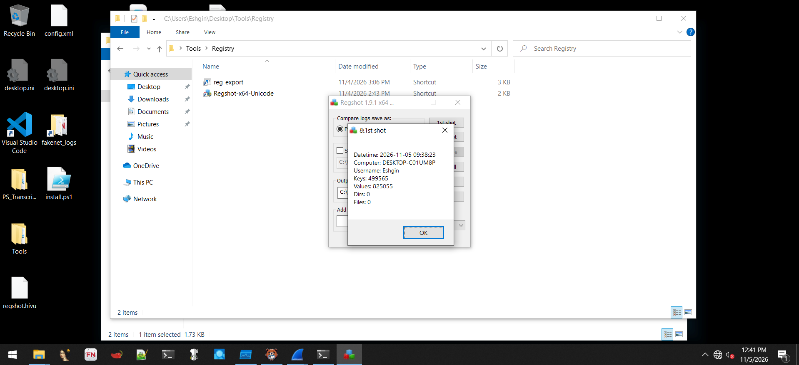
  <br><sub><b>Figure 39.</b> Regshot 1st shot: 499,565 keys and 825,055 values before execution.</sub>
</p>


### 9.2 Process Monitor configuration

Procmon writes to a **backing file** (`C:\Logs\procmonlogs.pml`) rather than virtual memory because ransomware produces millions of events.

<p align="center">
  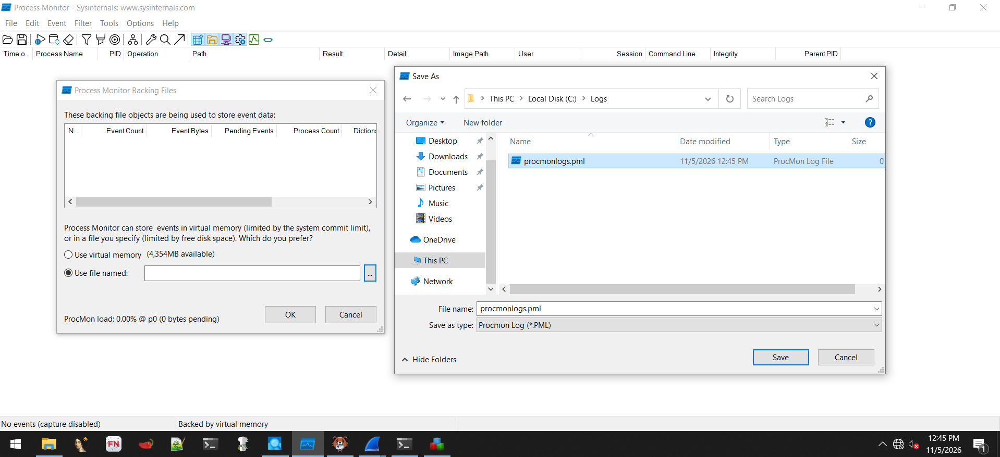
  <br><sub><b>Figure 40.</b> Procmon backing-file dialog and Save As: C:\\Logs\\procmonlogs.pml.</sub>
</p>


Include filters: `Process Name is BlackBasta.exe`, `RegSetValue`, `RegCreateKey`, `Process Create`, `WriteFile`, `UDP Send`, `UDP Connect`, `TCP Send`, and `SetRenameInformationFile` (being added).

<p align="center">
  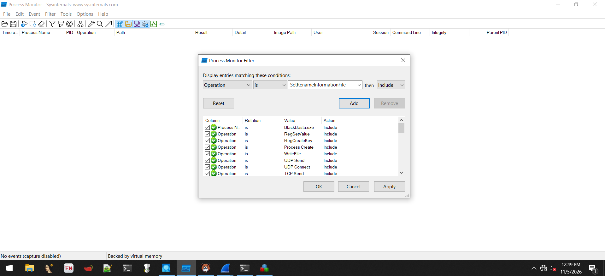
  <br><sub><b>Figure 41.</b> Process Monitor Filter: include rules for BlackBasta.exe and key operations; SetRenameInformationFile being added.</sub>
</p>


### 9.3 Network simulation (FakeNet-NG)

FakeNet-NG loaded `default.ini`, started **Diverter** capturing to a timestamped PCAP, set a gateway on `Ethernet0`, started a DNS server and installed its root certificate (`fakenet.flare`) so TLS interception works. Wireshark (dumpcap) ran alongside.

<p align="center">
  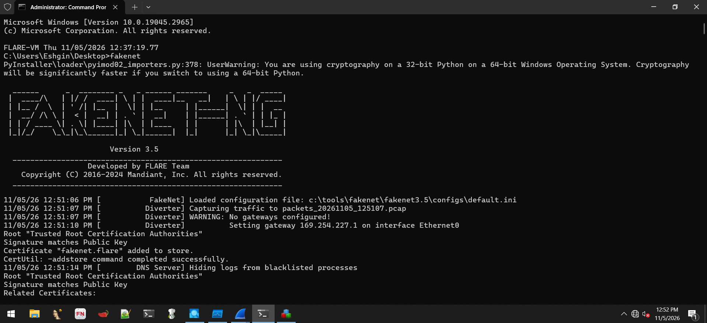
  <br><sub><b>Figure 43.</b> FakeNet-NG 3.5: configuration loaded, Diverter capturing to packets_20261105_125107.pcap, root certificate installed, DNS server started.</sub>
</p>


### 9.4 Process tree

<p align="center">
  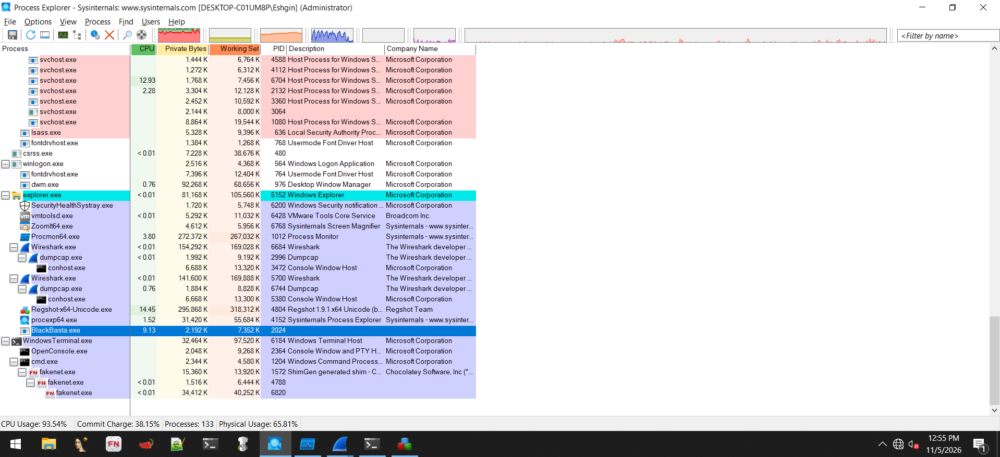
  <br><sub><b>Figure 46.</b> Process Explorer: BlackBasta.exe (PID 2024) under explorer.exe (PID 5152), next to Procmon, Wireshark/dumpcap, Regshot and FakeNet-NG; CPU usage 93.5%.</sub>
</p>


`BlackBasta.exe` (**PID 2024**) was launched from the interactive desktop (**parent `explorer.exe`**) at **Medium integrity** - consistent with the `asInvoker` manifest - and drove CPU to ~93%.

### 9.5 Procmon findings - first capture (4.83 M events)

<p align="center">
  
  <br><sub><b>Figure 44.</b> Procmon: BlackBasta.exe starts conhost.exe/cmd.exe, sets registry values, writes temp files, changes the wallpaper and drops readme.txt in many directories.</sub>
</p>


| VM time | Operation | Path / detail | Interpretation |
|---|---|---|---|
| 12:52:36 | `Process Create` | `System32\Conhost.exe` | console host for a child shell |
| 12:52:36 | `Process Create` | `SysWOW64\cmd.exe` (x2) | command execution (32-bit shell on 64-bit OS) |
| 12:52:36 | `RegSetValue` | `HKLM\System\CurrentControlSet\Servic...` (REG_BINARY) | service-key write (path truncated in screenshot) |
| 12:52:37 | `WriteFile` | `%LOCALAPPDATA%\Temp\...` | temporary artifacts |
| 12:52:37 | `RegSetValue` | `HKCU\Control Panel\Desktop\Wallpaper` (REG_SZ) | wallpaper changed to the ransom message |
| 12:52:37 | `RegCreateKey` | `HKCR\.basta\DefaultIcon` -> NAME NOT FOUND | icon for `.basta` files being defined |
| 12:52:37 | `RegCreateKey` | `HKCR\.basta` -> **ACCESS DENIED** | file-association creation blocked (non-elevated) |
| 12:52:37 -> | `WriteFile` | `<dir>\readme.txt` | **ransom note dropped everywhere** (`C:\Logs`, `C:\ProgramData\...`, `C:\Tools\...`, `C:\Users\Public\Documents`) |

> The `HKCR\.basta` write failed with **ACCESS DENIED** because the sample ran at Medium integrity. With administrative rights it would be able to register the extension and icon.

The ransom note is placed in **tool and system directories too** - not only user documents.

### 9.6 Encryption evidence

<p align="center">
  
  <br><sub><b>Figure 47.</b> Files in a C:\\Tools subfolder renamed with the .basta extension (type "BASTA File"); all modified at 12:52 PM while Procmon streams WriteFile events.</sub>
</p>


- Original file names are preserved and **`.basta` is appended**.
- Windows classifies the files as **"BASTA File"**.
- Identical modification timestamps (12:52 PM) show encryption started **seconds after execution**.
- The analyst's **own tools** were encrypted - the reason the VM must be reverted to the clean snapshot after every run.

### 9.7 Second capture - scale of activity (22.1 M events)

<p align="center">
  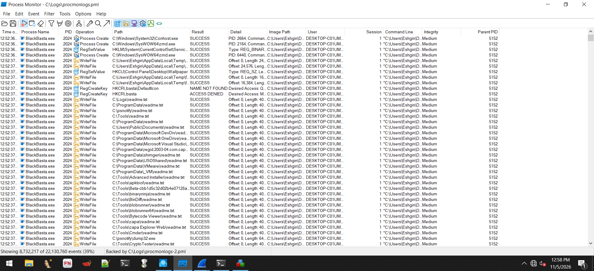
  <br><sub><b>Figure 48.</b> Second Procmon capture (procmonlogs-2.pml): 22.1 million events; the same behavior pattern at far higher volume.</sub>
</p>


### 9.8 Ransom note

<p align="center">
  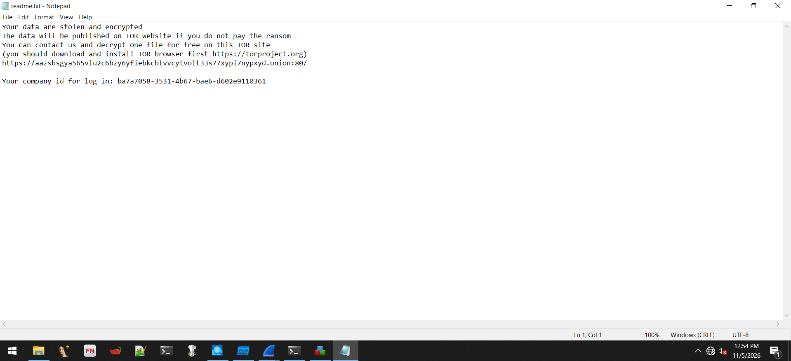
  <br><sub><b>Figure 45.</b> readme.txt - the ransom note dropped into each directory.</sub>
</p>


The note claims data were **stolen and encrypted**, threatens publication on a **TOR leak site**, offers to decrypt **one file for free**, and gives a TOR link and a **unique company ID**. It matches the 421-byte string found statically - **static-to-dynamic correlation confirmed**.

### 9.9 Registry delta and desktop impact

<p align="center">
  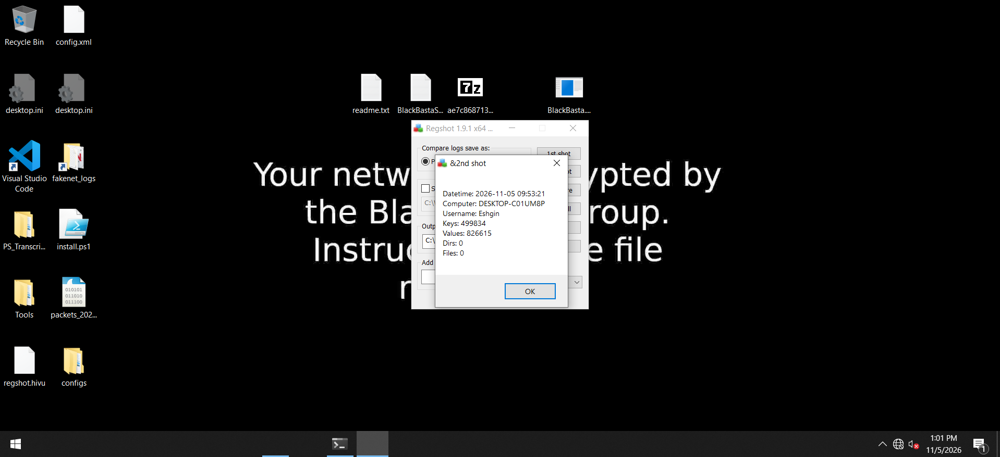
  <br><sub><b>Figure 49.</b> Regshot 2nd shot: 499,834 keys and 826,615 values; the ransom wallpaper is visible behind the dialog.</sub>
</p>


| | Keys | Values |
|---|---|---|
| 1st shot (before) | 499,565 | 825,055 |
| 2nd shot (after) | 499,834 | 826,615 |
| **Delta** | **+269** | **+1,560** |

The delta includes normal Windows background churn. **Procmon is the authoritative source** for attributing changes to the sample (Wallpaper value, `.basta` key attempts, service-key write).

<p align="center">
  
  <br><sub><b>Figure 50.</b> Desktop after execution: wallpaper "Your network is encrypted by the Black Basta group. Instructions in the file readme.txt"; readme.txt icons on the desktop.</sub>
</p>

<p align="center">
  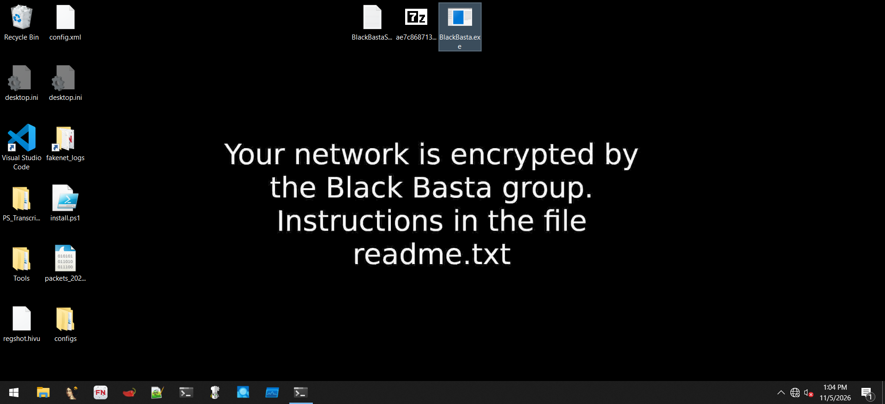
  <br><sub><b>Figure 51.</b> Later desktop state (13:04 VM time): the ransom wallpaper remains applied.</sub>
</p>


### 9.10 Dynamic analysis conclusions

1. Execution is **fast, noisy and multi-threaded** (~93% CPU, tens of millions of file events).
2. **Admin rights are not required** to encrypt user-writable data; some actions (`HKCR` writes, shadow-copy deletion) need elevation.
3. **`readme.txt` mass creation, `.basta` renames and the wallpaper change** are reliable detection points.
4. **Static predictions were validated dynamically** (note text, file renaming, registry changes).
5. Network behavior beyond the ransom note was not observable (offline lab); FakeNet-NG saved traffic attempts to a PCAP for review.

---

## 10. Behavior Timeline

All times are VM clock times on **2026-11-05** (screenshot taskbar clock), unless noted.

| Time | Activity |
|---|---|
| 12:20 | Sample extracted to the desktop |
| 12:22 | FLOSS string extraction |
| 12:23 - 12:30 | capa analysis |
| 12:25 | HashMyFiles hashing |
| 12:26 | Detect It Easy, PEiD |
| 12:27 - 12:29 | pestudio (footprints, sections, imports, strings, indicators) |
| 12:38 - 12:41 | Regshot baseline ("1st shot") |
| 12:45 - 12:49 | Procmon backing file and filters |
| 12:50 | PE-bear entry-point inspection |
| 12:51 | FakeNet-NG started, PCAP capture begins |
| **12:52:36** | **`BlackBasta.exe` executes** - `cmd.exe`/`conhost.exe` spawned |
| 12:52:37 | Wallpaper registry change, `.basta` key attempts, `readme.txt` dropping begins |
| 12:55 | Process Explorer: sample at ~93% CPU |
| 12:56 - 12:58 | Second Procmon capture grows to 22.1 M events; `.basta` files visible |
| 13:01 | Regshot "2nd shot" |
| 13:02 - 13:04 | Ransom wallpaper and desktop state documented |

> Regshot prints timestamps on a different clock basis than the VM taskbar (approximately 3 hours earlier). Use Procmon/VM time for correlation.

---

## 11. MITRE ATT&CK Mapping

*Confidence:* **High** = observed in dynamic telemetry; **Medium** = strong static evidence (capa/strings/imports); **Low** = sandbox/heuristic only, not confirmed locally.

| Tactic | ID | Technique | Evidence | Confidence |
|---|---|---|---|---|
| Execution | T1059.003 | Windows Command Shell | `cmd.exe` and `conhost.exe` spawned (Procmon) | High |
| Execution | T1129 | Shared Modules | capa; runtime linking via PEB | Medium |
| Execution | T1106 | Native API | direct use of Win32 file/volume/process APIs (imports) | Medium |
| Defense Evasion | T1027 | Obfuscated Files or Information | capa: 3 stack-string matches; FLOSS: 12 stack strings | Medium |
| Defense Evasion | T1027.005 | Indicator Removal from Tools | capa | Medium |
| Defense Evasion | T1497.001 | Virtualization/Sandbox Evasion: System Checks | capa: VirtualBox anti-VM strings | Medium |
| Defense Evasion | T1070.004 | Indicator Removal: File Deletion | capa | Medium |
| Discovery | T1083 | File and Directory Discovery | `FindFirstFileExW`/`FindNextFileW` and mass directory traversal (Procmon) | High |
| Discovery | T1082 | System Information Discovery | capa; processor-count and disk-info APIs | Medium |
| Discovery | T1120 | Peripheral Device Discovery (volume enumeration) | `FindFirstVolumeW`, `FindNextVolumeW` | Medium |
| **Impact** | **T1486** | **Data Encrypted for Impact** | `.basta` files, Salsa20/ChaCha constants, ransom note | **High** |
| **Impact** | **T1490** | **Inhibit System Recovery** | `vssadmin delete shadows /all /quiet` strings; capa | Medium |
| Impact | T1491.001 | Defacement: Internal Defacement | wallpaper registry change and ransom wallpaper | High |
| Persistence / Priv. Esc. | T1547 | Boot or Logon Autostart Execution | sandbox matrix; truncated service-key write | Low |
| Defense Evasion | T1055 | Process Injection | sandbox matrix only | Low |

> Low-confidence rows are listed for completeness and require debugger or API-trace validation before use in a formal report.

---

## 12. Indicators of Compromise

### 12.1 File indicators

| Type | Value |
|---|---|
| SHA-256 | `ae7c868713e1d02b4db60128c651eb1e3f6a33c02544cc4cb57c3aa6c6581b6e` |
| SHA-1 | `a996ccd0d58125bf299e89f4c03ff37afdab33fc` |
| MD5 | `53fdeb923b1890d29b8f29da77995938` |
| Imphash | `b3794746554a5701b2de3e5ea435c59b` |
| SSDEEP | `12288:M1DTMHixr1moQqUiXINDl/m1s6BQio67VlAU:AzmoQqUiXw2s6yiVxR` |
| TLSH | `T1D9C47C213581C43BD6A243B04DACDA95727DBC300F6206CBE3D45A6E5A7C5F27B329B6` |
| Rich PE header hash | `097c3efd91e657b69051326b4792cc68` |
| Compile timestamp | 2022-04-16 06:29:58 UTC |
| Overlay (32 B) | `02981b768d214cd8a05a2ee0f8cb76af` |

### 12.2 Host indicators

| Type | Value |
|---|---|
| Ransom note | `readme.txt` written into many directories |
| Encrypted-file extension | `.basta` ("BASTA File") |
| Wallpaper text | "Your network is encrypted by the Black Basta group. Instructions in the file readme.txt." |
| Registry | `HKCU\Control Panel\Desktop\Wallpaper` modified |
| Registry | `HKCR\.basta`, `HKCR\.basta\DefaultIcon` creation attempted |
| Child processes | `SysWOW64\cmd.exe`, `System32\conhost.exe` |
| Embedded command | `vssadmin.exe delete shadows /all /quiet` |
| Console string | `Done time: %.4f seconds, encrypted: %.4f gb` |

### 12.3 Network indicators (from the ransom note)

| Type | Value |
|---|---|
| TOR negotiation site | `aazsbsgya565vlu2c6bzy6yfiebkcbtvvcytvolt33s77xypi7nypxyd.onion` (port 80) |
| Victim ID format | UUID (unique per victim/build) |

> These network IOCs come from the ransom note, **not** from live C2 traffic. Do not browse `.onion` addresses from a production network.

A machine-readable list is in [`iocs/iocs.csv`](iocs/iocs.csv).

---

## 13. Detection Engineering

| # | Behavior | Data source | Fidelity |
|---|---|---|---|
| 1 | `vssadmin.exe delete shadows` (also `wmic shadowcopy delete`, `wbadmin delete`, `bcdedit` recovery tampering) | Sysmon EID 1 / Security 4688 | High |
| 2 | Same file name (`readme.txt`) created in hundreds of directories within seconds | Sysmon EID 11 / EDR | High |
| 3 | Mass renames/creation of files with an uncommon extension (`.basta`) | Sysmon EID 11, 2 / EDR | High |
| 4 | `SysWOW64\cmd.exe` spawned by an unsigned binary in a user-writable path | Sysmon EID 1 | Medium |
| 5 | `HKCU\Control Panel\Desktop\Wallpaper` changed by a non-system process | Sysmon EID 13 | Medium |
| 6 | Attempt to create `HKCR\.<random ext>` / `DefaultIcon` | Sysmon EID 12/13 | Medium |
| 7 | One process with extreme CPU and file I/O | EDR / perf telemetry | Low-Medium |

**Sigma rules:** [`detections/sigma/shadow_copy_deletion_vssadmin.yml`](detections/sigma/shadow_copy_deletion_vssadmin.yml) and [`detections/sigma/ransom_note_mass_creation.yml`](detections/sigma/ransom_note_mass_creation.yml).

**KQL hunting examples**

```kql
// Shadow-copy deletion
DeviceProcessEvents
| where FileName =~ "vssadmin.exe"
| where ProcessCommandLine has_all ("delete", "shadows")
| project Timestamp, DeviceName, AccountName, InitiatingProcessFileName, ProcessCommandLine
```

```kql
// One process dropping the same note into many folders
DeviceFileEvents
| where ActionType == "FileCreated" and FileName =~ "readme.txt"
| summarize Dirs=dcount(FolderPath), Files=count() by DeviceName, InitiatingProcessFileName, bin(Timestamp, 1m)
| where Dirs > 50
```

---

## 14. Mitigation and Hardening Recommendations

| Area | Recommendation |
|---|---|
| **Backups** | 3-2-1 strategy with at least one offline/immutable copy; test restores regularly. Shadow copies alone are *not* a backup. |
| **Endpoint protection** | Keep EDR/AV and **Tamper Protection enabled**; enable ASR rules (e.g. "Use advanced protection against ransomware"). |
| **Privilege control** | Remove local admin rights; restrict `vssadmin`, `wbadmin`, `bcdedit` with AppLocker/WDAC. |
| **Initial access** | Patch internet-facing systems, enforce MFA on VPN/RDP, filter risky attachments (ISO/LNK/macros). |
| **Network** | Segment the network, restrict SMB/admin shares, monitor and block TOR egress. |
| **Data protection** | Controlled Folder Access on high-value workstations. |
| **Incident response** | Rehearsed playbook: isolate, preserve memory, find patient zero, rotate credentials, restore from clean backups. |

**Response checklist if this family is detected**

- [ ] Isolate affected hosts (do not power off if memory capture is required)
- [ ] Preserve volatile data and the sample; compare hashes with the IOCs above
- [ ] Search file shares for `.basta` files and `readme.txt` notes
- [ ] Look for shadow-copy deletion and preceding lateral movement
- [ ] Reset credentials and review privileged accounts
- [ ] Restore from known-good backups and validate before reconnecting

---

## 15. Skills Demonstrated

- Secure malware-lab design (hypervisor isolation, snapshots, network segmentation)
- FLARE-VM deployment and tooling management
- Static analysis: PE format, hashing, packer/compiler identification, FLOSS, capa, pestudio, PE-bear
- Behavioral analysis: Procmon, Process Explorer, Regshot, FakeNet-NG, Wireshark
- Threat-intelligence enrichment (VirusTotal, YARA, sandbox reports)
- MITRE ATT&CK mapping with evidence and confidence levels
- IOC extraction and detection engineering (Sigma, KQL)
- Technical writing and documentation

---

## 16. Limitations and Future Work

**Limitations**

- No debugger/decompiler-level analysis of the encryption routine; cryptographic statements rely on capa/FLOSS evidence and public reporting.
- Offline execution: no real TOR/C2 behavior observed.
- Single run on a single OS build and privilege level.
- Items marked *hypothesis* or *Low confidence* were not verified by reverse engineering.

**Future work**

1. Reverse the encryption routine in **Ghidra / x64dbg** (key generation, chunking, file header/footer).
2. Capture child-process **command lines** with Sysmon and export a full process tree.
3. Compare **elevated vs non-elevated** execution.
4. Develop and test a **YARA rule** from unique strings and code patterns.
5. Analyze the **FakeNet-NG PCAP** for DNS/HTTP attempts.
6. Compare with newer Black Basta builds (including ESXi/Linux variants).

---

## 17. Tool Reference

| Phase | Tool | Purpose |
|---|---|---|
| Virtualization | VMware Workstation | Hypervisor, snapshots, LAN segments |
| Toolkit | FLARE-VM, Boxstarter, Chocolatey | Analysis environment |
| Identification | HashMyFiles, Detect It Easy, PEiD | Hashes, compiler/packer |
| Static | pestudio, PE-bear, FLOSS, capa | PE structure, strings, capabilities |
| Threat intel | VirusTotal | Detections, YARA, sandbox, ATT&CK |
| Dynamic | Regshot, Process Monitor, Process Explorer | Registry, process, file telemetry |
| Network | FakeNet-NG, Wireshark | Simulated services, packet capture |

---

## 18. References

- Mandiant FLARE-VM - https://github.com/mandiant/flare-vm
- FLOSS - https://github.com/mandiant/flare-floss
- capa - https://github.com/mandiant/capa
- FakeNet-NG - https://github.com/mandiant/flare-fakenet-ng
- Sysinternals - https://learn.microsoft.com/sysinternals/
- pestudio - https://www.winitor.com/
- MITRE ATT&CK - https://attack.mitre.org/
- Elastic protections-artifacts (YARA) - https://github.com/elastic/protections-artifacts

---

## 19. Disclaimer and License

This project is intended **solely for educational and defensive research**. The malware sample is **not distributed** here. The author assumes no liability for misuse of the information. Released under the **MIT License**.

<p align="center"><sub>If you find this project useful, consider giving it a star.</sub></p>
