# 01 - Lab Setup

This document describes how the analysis environment was created, isolated and snapshotted **before** any malware was introduced.

## 1.1 Virtual machine creation

A new VM was created in VMware Workstation from a **Windows 10 22H2 x64** ISO. VMware detected the OS and used *Easy Install*.

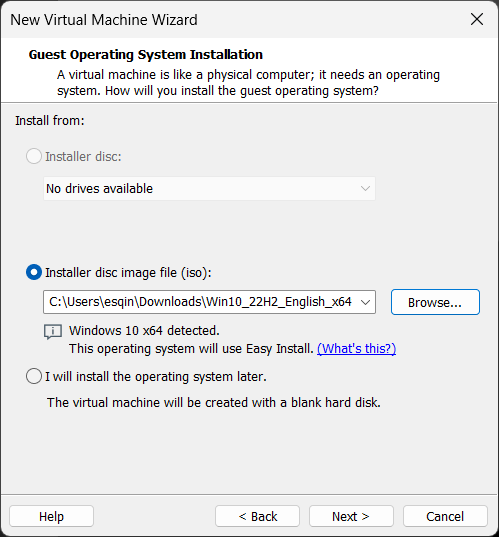 <b>Figure 01.</b> New Virtual Machine Wizard - Windows 10 22H2 x64 ISO selected.

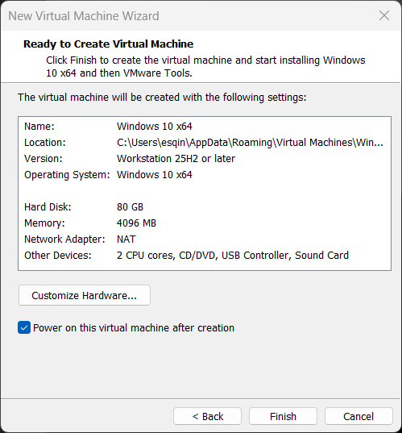 <b>Figure 02.</b> VM summary: 80 GB disk, 4096 MB RAM, 2 CPU cores, NAT adapter (changed later to an isolated LAN segment).

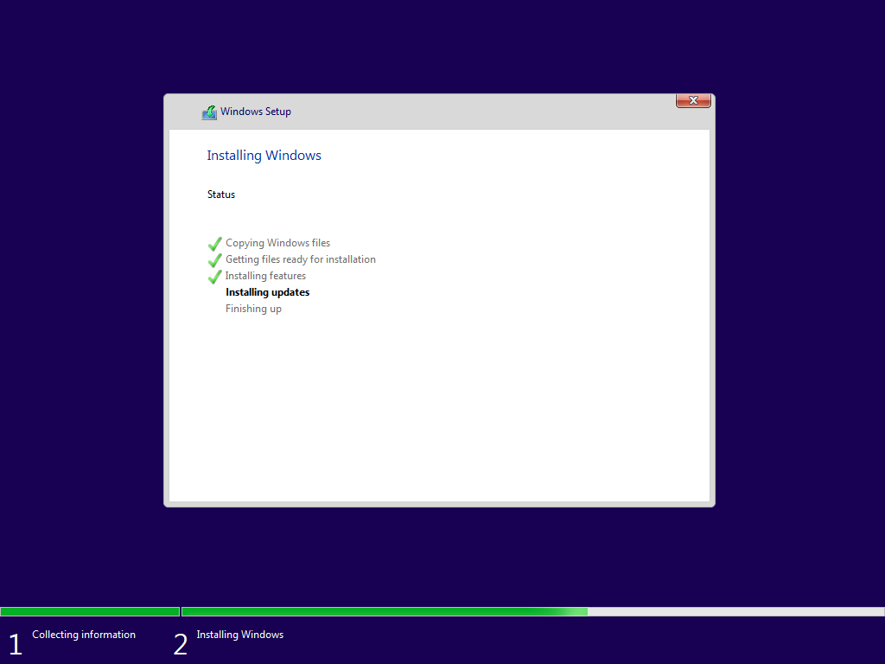 <b>Figure 03.</b> Windows Setup - file copy and update installation phase.

 <b>Figure 04.</b> First boot into the analysis VM (hostname profile `FLARE-VM`).

| Setting | Value |
|---|---|
| Name | Windows 10 x64 |
| Hardware version | Workstation 25H2 or later |
| Disk | 80 GB (NVMe) - above the 60 GB FLARE-VM recommendation |
| Memory | 4096 MB |
| CPU | 2 cores |
| Initial network | NAT (needed temporarily to download FLARE-VM packages) |

## 1.2 Guest isolation

To prevent data leaking between guest and host, the following were configured under **VM Settings -> Options**:

- **Enable drag and drop:** off
- **Enable copy and paste:** off
- **Shared Folders:** disabled
- Sensor sharing (orientation, motion, ambient light): off

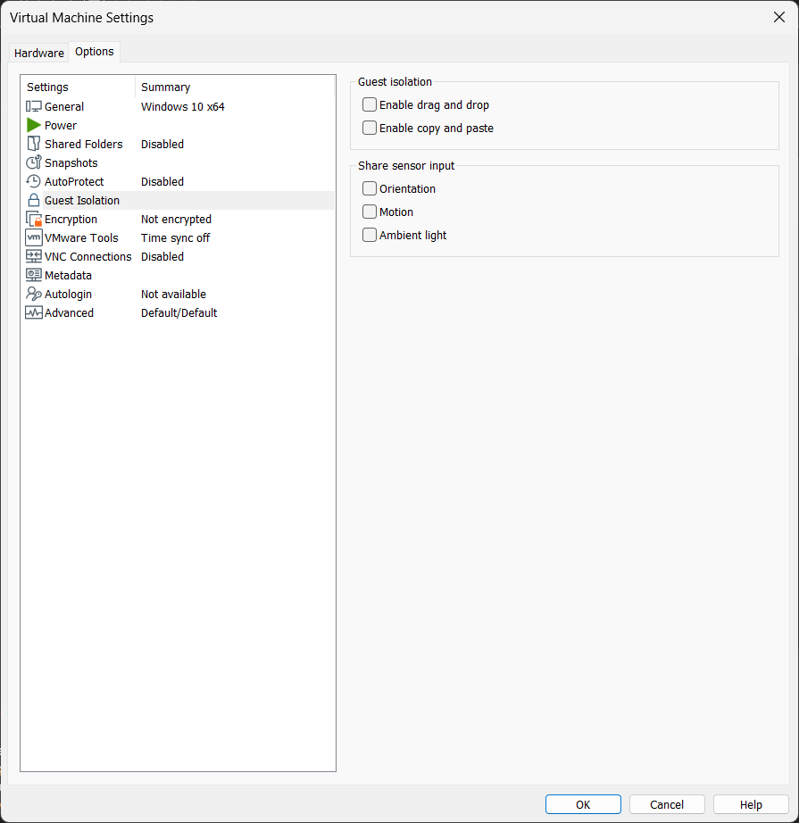 <b>Figure 05.</b> Guest Isolation settings - drag/drop and copy/paste disabled; Shared Folders disabled.

## 1.3 Disabling Windows Update and Defender

FLARE-VM refuses to install while Microsoft Defender and Tamper Protection are active, and uncontrolled updates change the VM state mid-analysis. Both were therefore disabled **inside the throwaway VM only**.

**Windows Update service (`wuauserv`)** - startup type set to *Disabled* and the service stopped:

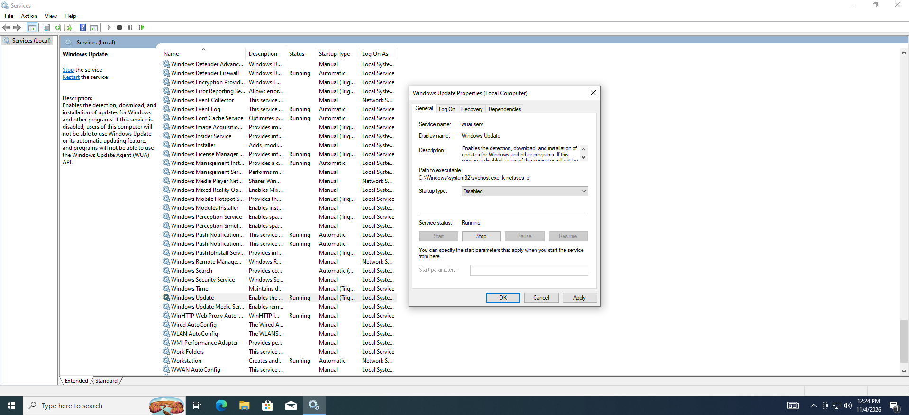 <b>Figure 06.</b> Windows Update properties - startup type Disabled, service still Running.

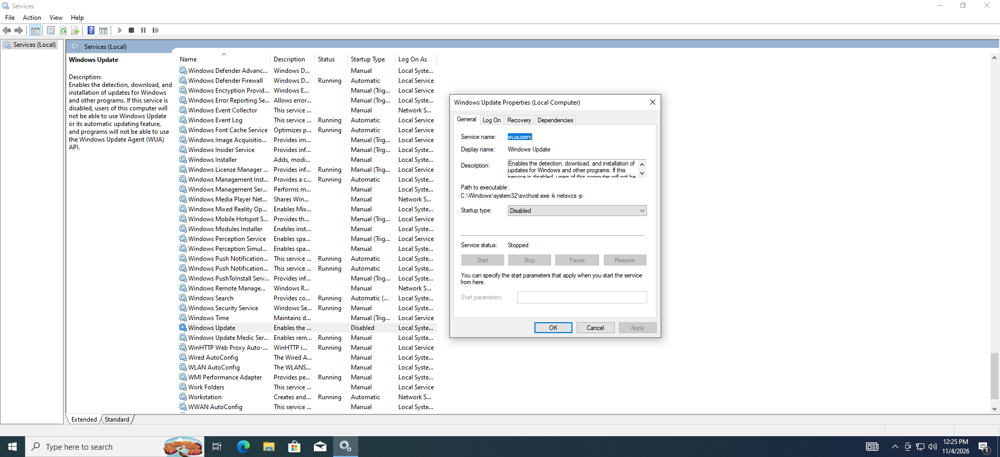 <b>Figure 07.</b> Windows Update - service Stopped, startup type Disabled.

**Microsoft Defender** - real-time protection, cloud-delivered protection, automatic sample submission and Tamper Protection set to *Off*:

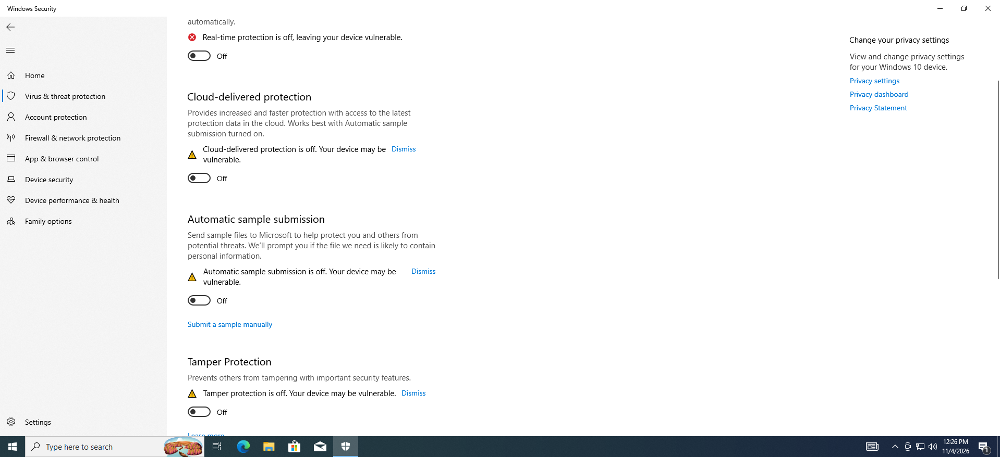 <b>Figure 08.</b> Windows Security - real-time, cloud, sample submission and tamper protection all off.

**Group Policy** - *Turn off Microsoft Defender Antivirus* set to **Enabled** (`gpedit.msc` -> Computer Configuration -> Administrative Templates -> Windows Components -> Microsoft Defender Antivirus) so Defender stays off after reboot:

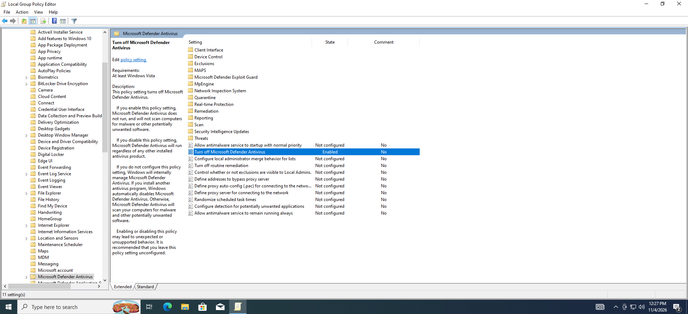 <b>Figure 09.</b> Local Group Policy Editor - "Turn off Microsoft Defender Antivirus" = Enabled.

> These changes are acceptable only because the VM is disposable and network-isolated. Never apply them to a production machine.

## 1.4 FLARE-VM installation

FLARE-VM was installed with Mandiant's PowerShell installer from an elevated PowerShell prompt (script downloaded, unblocked, execution policy set to Unrestricted, then run).

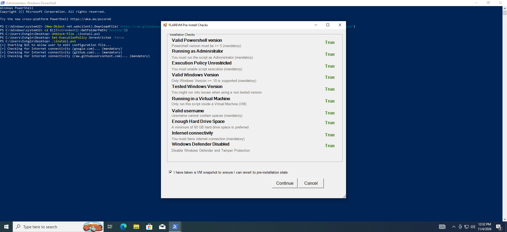 <b>Figure 10.</b> FLARE-VM pre-install checks - all nine checks True, including "Running in a Virtual Machine" and "Windows Defender Disabled", plus the snapshot confirmation tick-box.

The installer then bootstrapped **Boxstarter** and **Chocolatey** and asked for the install directories:

| Variable | Value |
|---|---|
| `%VM_COMMON_DIR%` | `%ProgramData%\_VM` |
| `%TOOL_LIST_DIR%` | `%UserProfile%\Desktop\Tools` |
| `%RAW_TOOLS_DIR%` | `%SystemDrive%\Tools` |

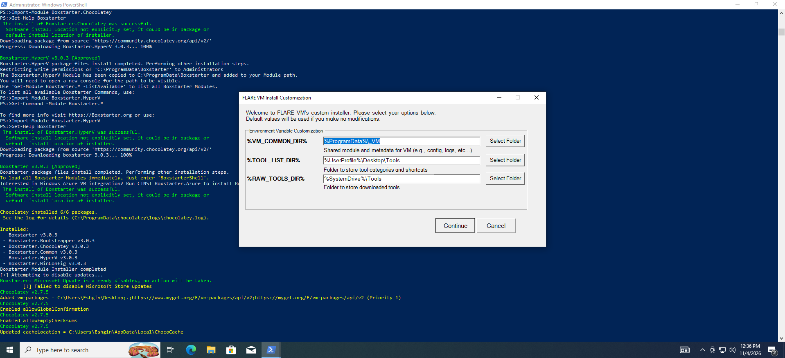 <b>Figure 11.</b> Boxstarter/Chocolatey bootstrap output and the FLARE-VM install customization dialog.

The package selector listed tools by category (debuggers, disassemblers, etc.). The recommended defaults were kept (e.g. x64dbg with plugins, WinDbg, Ghidra, Cutter, Binary Ninja, IDA Free), with `dotnet3.5` and `vcredist-all` added as extra packages.

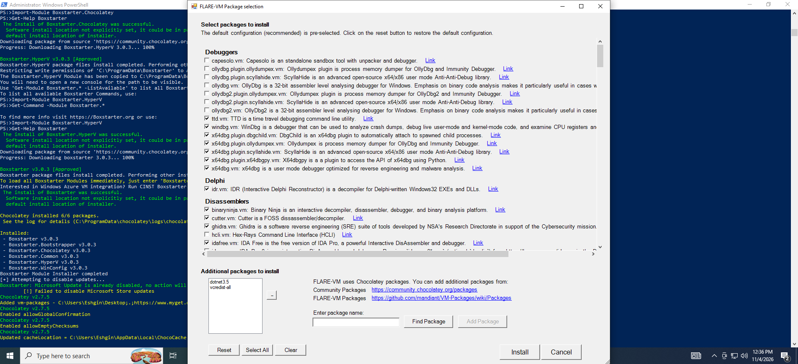 <b>Figure 12.</b> FLARE-VM package selection (debuggers, Delphi, disassemblers ...) with additional packages.

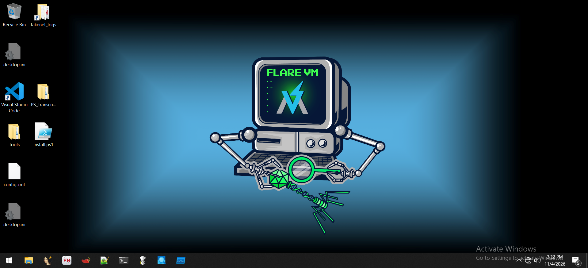 <b>Figure 13.</b> Finished FLARE-VM desktop: Tools folder, fakenet_logs shortcut, VS Code and the installer artifacts.

> The Boxstarter log showed one non-fatal warning: *"Failed to disable Microsoft Store updates"*. It had no effect on the analysis.

## 1.5 Network isolation

After installation the network adapter was moved from NAT to a **LAN Segment named `MalwareLab`**. A LAN segment is a private L2 network shared only with other VMs placed in the same segment, so the guest has **no route to the host, LAN or internet**.

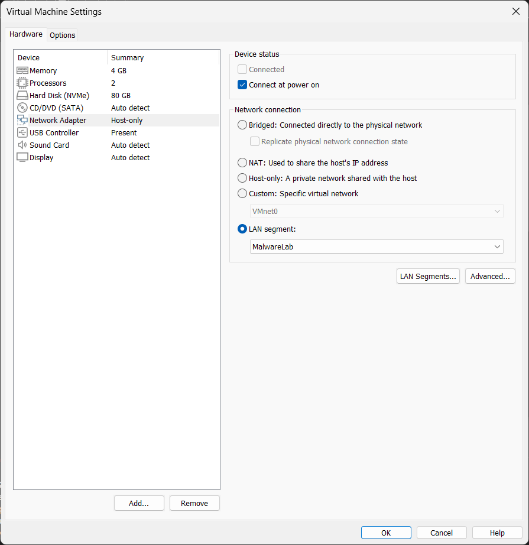 <b>Figure 14.</b> Network Adapter set to LAN segment "MalwareLab" with "Connect at power on" enabled.

Inside the guest, Windows reports *"Unidentified network / No Internet access"*, confirming isolation (visible in later screenshots). FakeNet-NG supplies simulated DNS/HTTP/TLS services so that network behavior can still be observed.

## 1.6 Clean snapshot

A snapshot named **`FLARE CLEAN`** was taken once the toolkit and isolation settings were final. The VM is reverted to this snapshot after every execution.

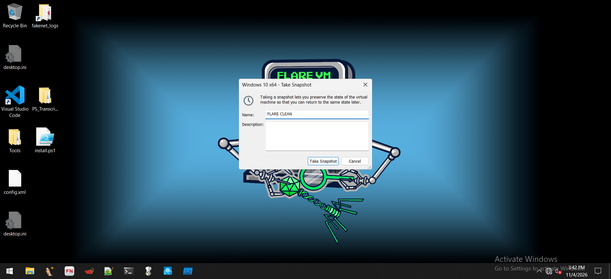 <b>Figure 16.</b> Take Snapshot dialog - name "FLARE CLEAN".

## 1.7 Pre-execution checklist

- [x] Guest isolation: clipboard, drag-and-drop, shared folders off
- [x] Adapter on isolated LAN segment, no NAT / bridged / host-only
- [x] Defender, Tamper Protection and Windows Update disabled
- [x] FLARE-VM installed
- [x] `FLARE CLEAN` snapshot created
- [x] Sample handled only as an archive until analysis begins
