# 02 - Static Analysis

Static analysis examines the file **without executing it**. All tools below ran inside the isolated FLARE-VM.

## 2.1 Sample staging

The sample was delivered as a 7-Zip archive named after its SHA-256 and extracted to the desktop as `BlackBasta.exe`.

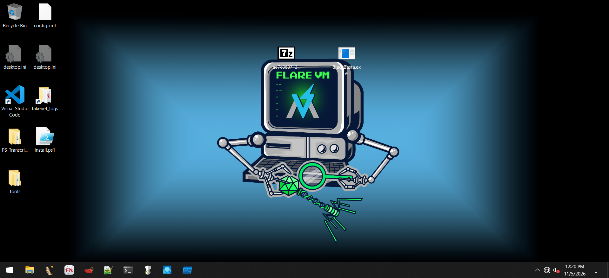 <b>Figure 17.</b> Desktop with the archive (named by SHA-256) and the extracted BlackBasta.exe.

## 2.2 Cryptographic hashes

HashMyFiles confirmed the hashes and file size:

| Algorithm | Value |
|---|---|
| MD5 | `53fdeb923b1890d29b8f29da77995938` |
| SHA-256 | `ae7c868713e1d02b4db60128c651eb1e3f6a33c02544cc4cb57c3aa6c6581b6e` |
| Size | 556,576 bytes |

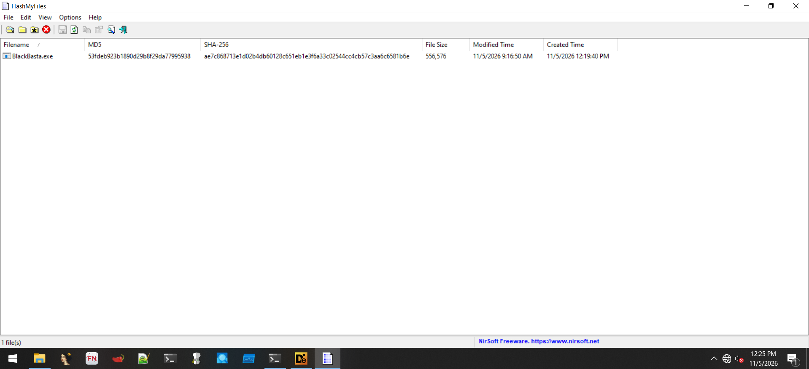 <b>Figure 20.</b> HashMyFiles output for BlackBasta.exe.

## 2.3 File type, compiler and packer identification

**Detect It Easy (v3.10)** reports a **PE32, 32-bit, console** program built with **Microsoft Linker 14.31 / MSVC 19.31.30818 (C++)** using **Visual Studio 2022 (v17.1)**, with a 32-byte plain-text **overlay** at offset `0x87E00`.

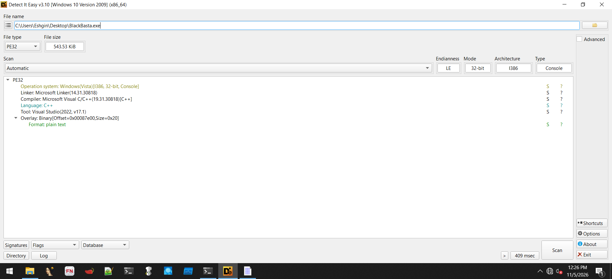 <b>Figure 21.</b> Detect It Easy - PE32 / MSVC C++ / Visual Studio 2022, overlay of 0x20 bytes.

**PEiD** agrees: entry point `0x0003576B` in `.text`, linker 14.31, signature "Microsoft Visual C++ 8 [Overlay]". No packer signature is present.

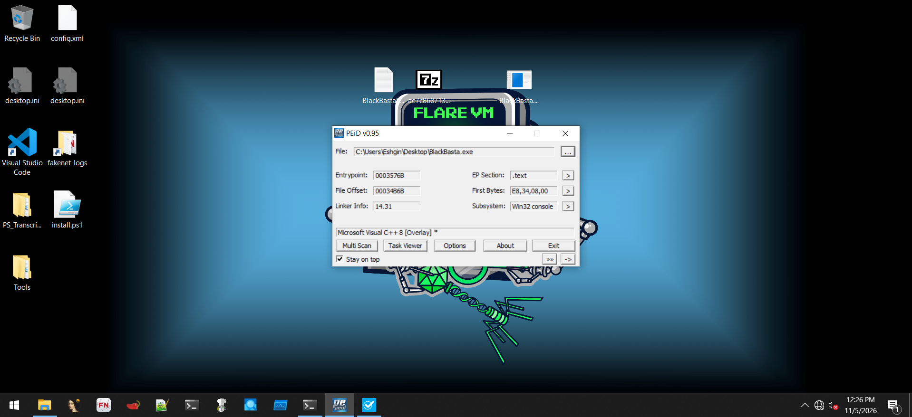 <b>Figure 22.</b> PEiD - entry point, section, linker version and compiler signature.

> **Conclusion:** the binary is not packed with a known packer. The overlay contains a 32-character hex string (`02981b768d214cd8a05a2ee0f8cb76af`) that was visible in pestudio.

## 2.4 PE structure (pestudio)

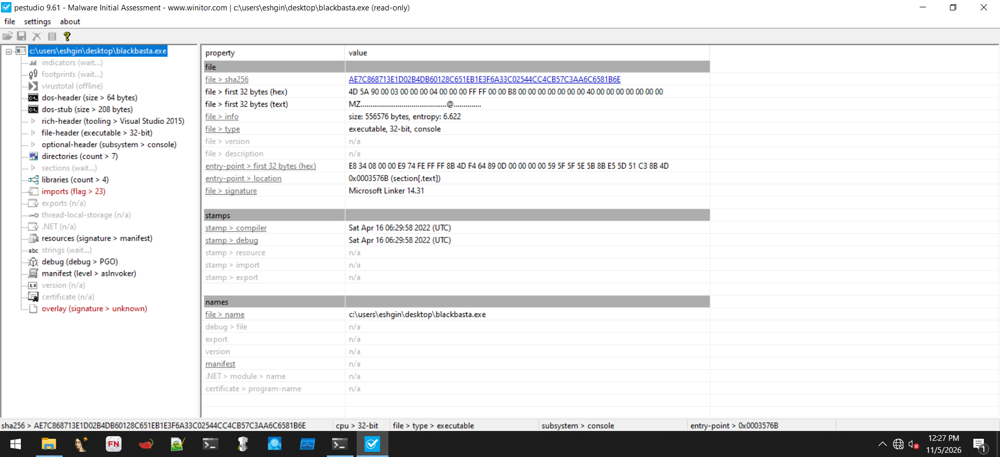 <b>Figure 23.</b> pestudio overview: SHA-256, entropy 6.622, compile timestamp 2022-04-16 06:29:58 UTC, entry point 0x3576B.

| Attribute | Value |
|---|---|
| Architecture | 32-bit (i386), console subsystem |
| Entropy (whole file) | 6.622 |
| Compiler stamp | Sat Apr 16 06:29:58 2022 (UTC) |
| Debug stamp | same as compiler stamp |
| Manifest | `asInvoker` (no UAC elevation requested) |
| Imphash | `b3794746554a5701b2de3e5ea435c59b` |
| Strings | 8,115 (pestudio) / 3,662 static (FLOSS) |

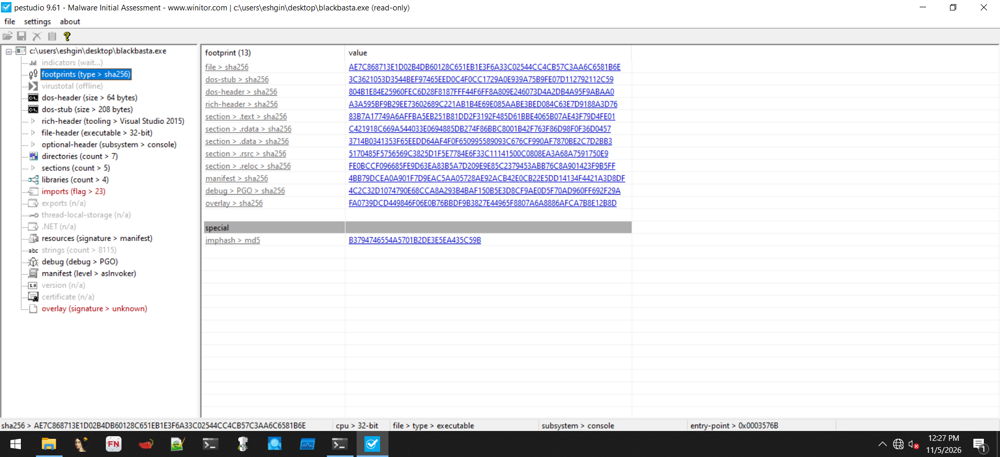 <b>Figure 24.</b> pestudio footprints: SHA-256 hashes of file, headers, each section, manifest, overlay and the imphash.

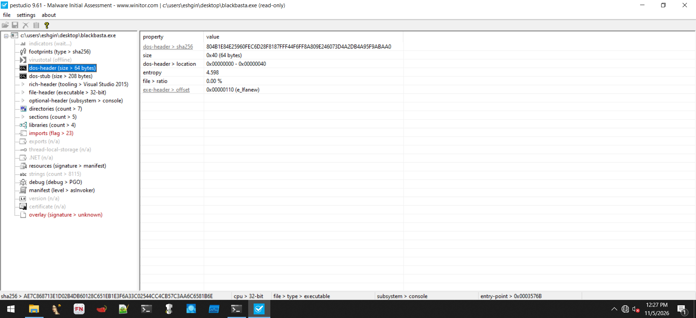 <b>Figure 25.</b> DOS header (64 bytes) with e_lfanew = 0x110.

### Sections

| Section | Raw size | Entropy | Notes |
|---|---|---|---|
| `.text` | 395,264 B (71.0%) | 6.594 | executable code |
| `.rdata` | 131,584 B (23.6%) | 5.750 | imports, debug, load-config, TLS directories |
| `.data` | 9,216 B (1.7%) | 3.900 | writable data |
| `.rsrc` | 512 B | 4.718 | manifest only (381 bytes) |
| `.reloc` | 18,944 B (3.4%) | 6.560 | relocations |

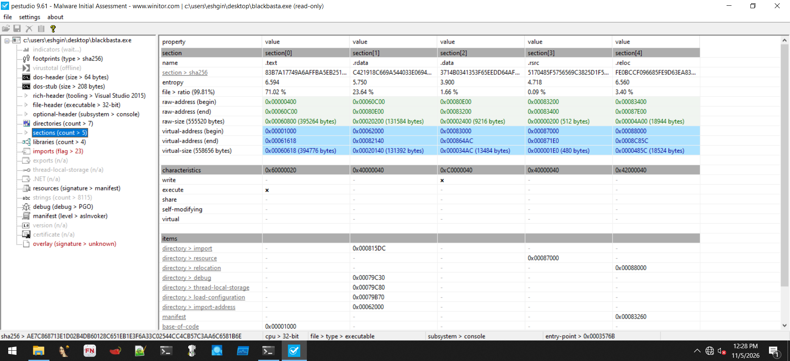 <b>Figure 26.</b> Section table: names, entropy, raw/virtual addresses and characteristics. Only .text is executable; only .data is writable.

No section has abnormally high entropy (> 7), which is consistent with an **unpacked** binary and normal section permissions (no writable+executable section).

### Imports

pestudio lists **120 imports, 23 flagged** as suspicious from 4 libraries. Notable APIs: `FindFirstFileExW`, `FindNextFileW`, `FindFirstVolumeW`, `FindNextVolumeW`, `GetVolumePathNamesForVolumeNameW` (volume/file enumeration), `MoveFileW` (renaming encrypted files), `DeviceIoControl`, `SetEnvironmentVariableW`, `GetCurrentProcessId`, `CreateProcessW`, `TerminateProcess`.

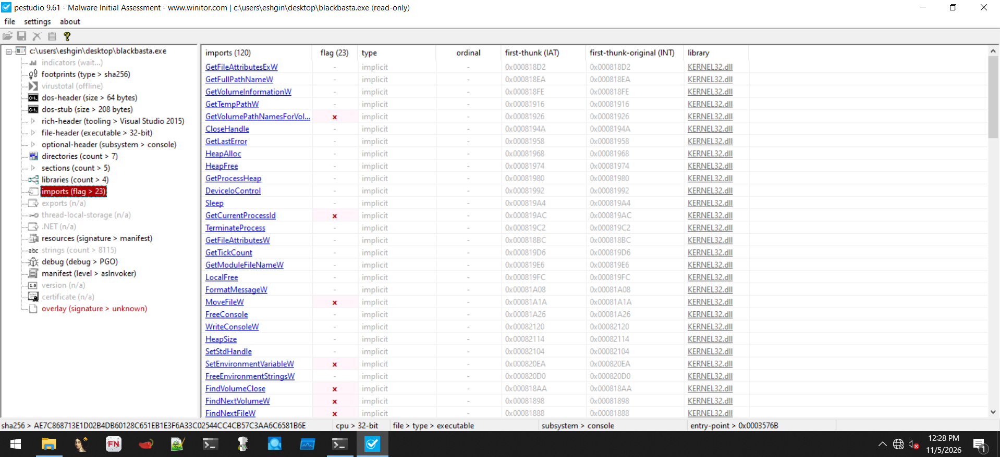 <b>Figure 27.</b> Imports view with flagged APIs (volume enumeration, MoveFileW, environment variables, process ID).

## 2.5 Strings

Two complementary approaches were used:

1. **pestudio** string view (8,115 strings).
2. **FLOSS v3.1.1** (static, stack, tight and decoded strings), output saved to `BlackBastaStrings.txt`.

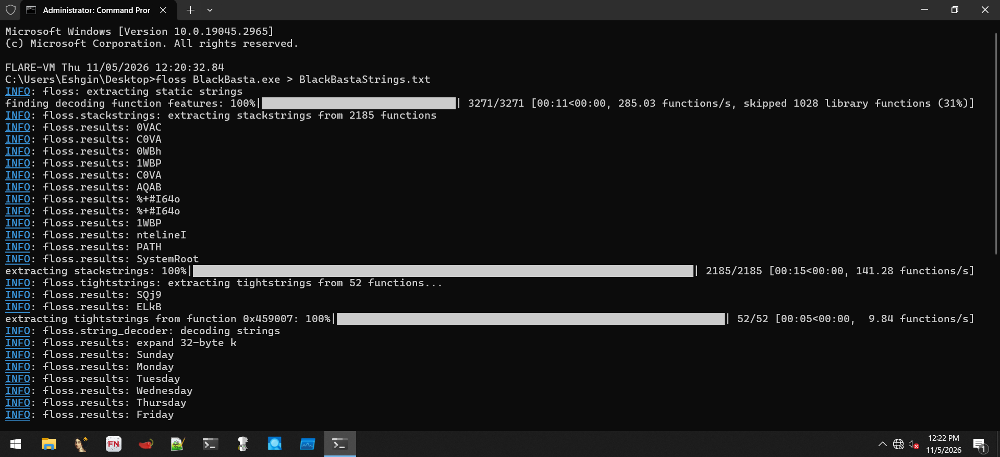 <b>Figure 18.</b> FLOSS being run from an elevated prompt: static, stack, tight and decoded string extraction.

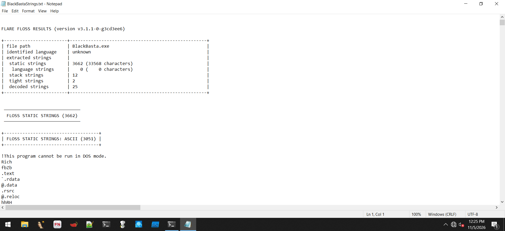 <b>Figure 19.</b> FLOSS result header: 3,662 static strings, 12 stack strings, 2 tight strings, 25 decoded strings.

### High-value strings

| String / artifact | Meaning |
|---|---|
| `C:\Windows\SysNative\vssadmin.exe delete shadows /all /quiet` | Delete all Volume Shadow Copies (64-bit path from a 32-bit process) |
| `C:\Windows\System32\vssadmin.exe delete shadows /all /quiet` | Same, native path fallback |
| `ENCRYPTION` | Status/progress label |
| `Done time: %.4f seconds, encrypted: %.4f gb` | Completion summary printed by the console binary |
| `Your data are stolen and encrypted ... published on TOR website ...` (421 bytes) | Ransom-note template |
| 684-character Base64-like blob | *Hypothesis:* embedded key material (e.g. a public key) - not verified |
| `gmp_default_alloc: Virtual memory exhausted.` | GMP big-number library linked in (typical of RSA code) |
| `expand 32-byte k` | Constant used by Salsa20/ChaCha stream ciphers |
| `ERRRROR with file`, `Error 755:` | Error messages |

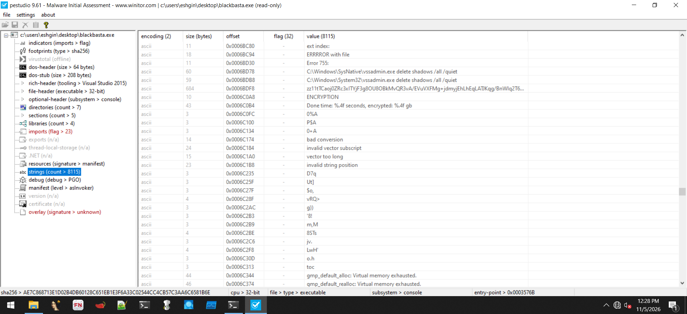 <b>Figure 28.</b> pestudio strings: vssadmin delete shadows (two paths), ENCRYPTION, completion message and the long Base64-like blob.

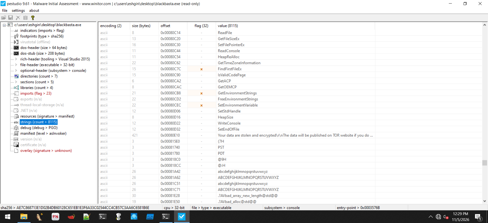 <b>Figure 29.</b> pestudio strings near the end of .rdata: the embedded ransom-note template ("Your data are stolen and encrypted...").

## 2.6 pestudio indicators

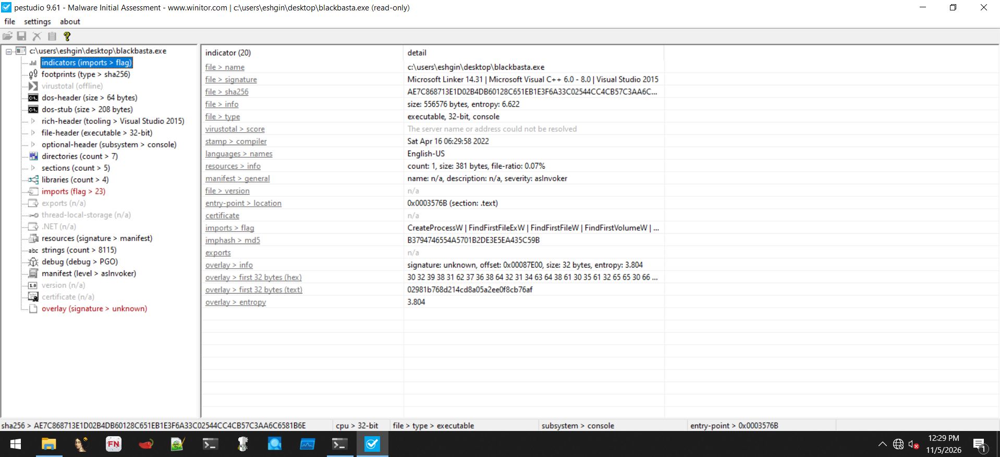 <b>Figure 30.</b> Indicators summary: file signature, compile stamp, 1 resource (381 B), manifest asInvoker, flagged imports, overlay info.

The overlay contains **32 bytes** with entropy 3.804 whose text form is the hex string noted above.

## 2.7 Capability detection with capa

capa (FLARE) mapped the binary to ATT&CK, MBC and individual capabilities.

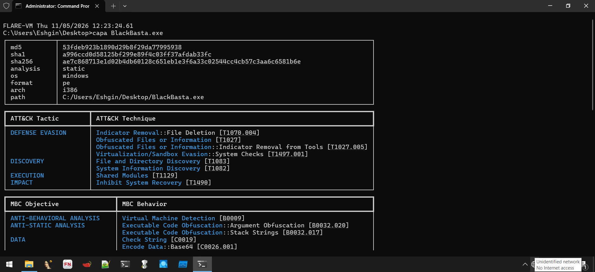 <b>Figure 31.</b> capa header and ATT&CK tactic/technique table (Defense Evasion, Discovery, Execution, Impact).

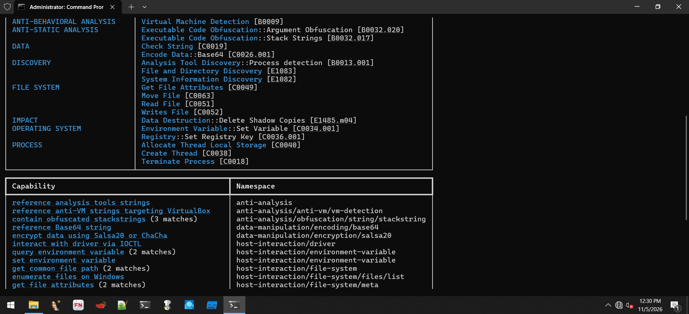 <b>Figure 32.</b> capa MBC behaviors and the start of the capability table (anti-VM, stackstrings, Base64, Salsa20/ChaCha, IOCTL ...).

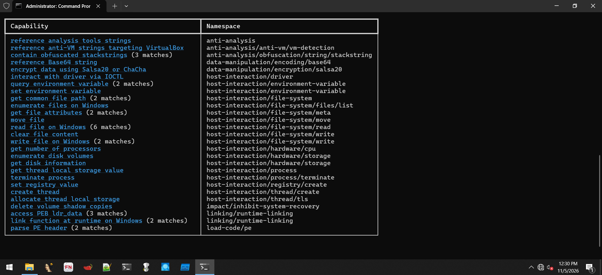 <b>Figure 33.</b> Complete capa capability table: file enumeration, read/write/move, volume enumeration, registry set value, create thread, delete volume shadow copies, PE header parsing ...

**ATT&CK (capa):** T1070.004, T1027, T1027.005, T1497.001, T1083, T1082, T1129, T1490.

**Notable capabilities**

- *anti-analysis*: references analysis-tool strings, anti-VM strings targeting VirtualBox, obfuscated stackstrings (3 matches)
- *data-manipulation*: Base64 string, **encrypt data using Salsa20 or ChaCha**
- *host-interaction*: driver interaction via **IOCTL**, environment-variable query/set, **enumerate files**, **enumerate disk volumes**, get disk information, number of processors, move/read/write/clear file, terminate process, set registry value, create thread, TLS
- *impact*: **delete volume shadow copies**
- *linking/load-code*: access PEB `ldr_data`, runtime function linking, parse PE header

## 2.8 Entry point inspection (PE-bear)

PE-bear loaded the sample and displayed the entry point (`0x34B6B` file offset / `0x3576B` RVA) in `.text`. The entry code is a standard MSVC CRT start-up stub (`call` into the security-cookie/CRT initialization followed by `jmp`), again consistent with an unpacked binary.

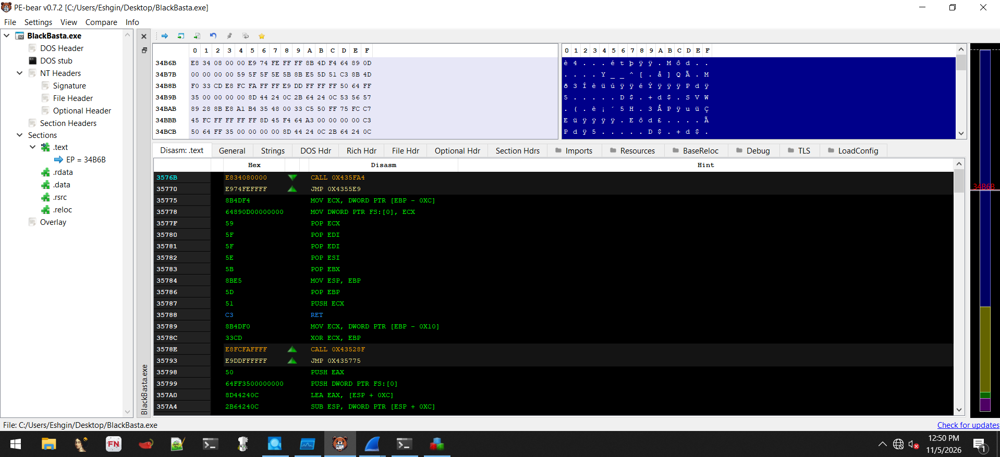 <b>Figure 43.</b> PE-bear disassembly at the entry point (EP = 34B6B) showing the MSVC CRT start-up stub.

## 2.9 Static analysis conclusions

1. The sample is an **unpacked 32-bit C++ Windows ransomware** built with VS 2022 in April 2022.
2. Capabilities: enumerate volumes/files, encrypt with a Salsa20/ChaCha-family cipher, rename files, delete shadow copies, set registry values, run multi-threaded.
3. Anti-analysis is limited: stackstrings and VirtualBox/analysis-tool string checks.
4. Embedded ransom note and key-like blob were identified for dynamic validation.
