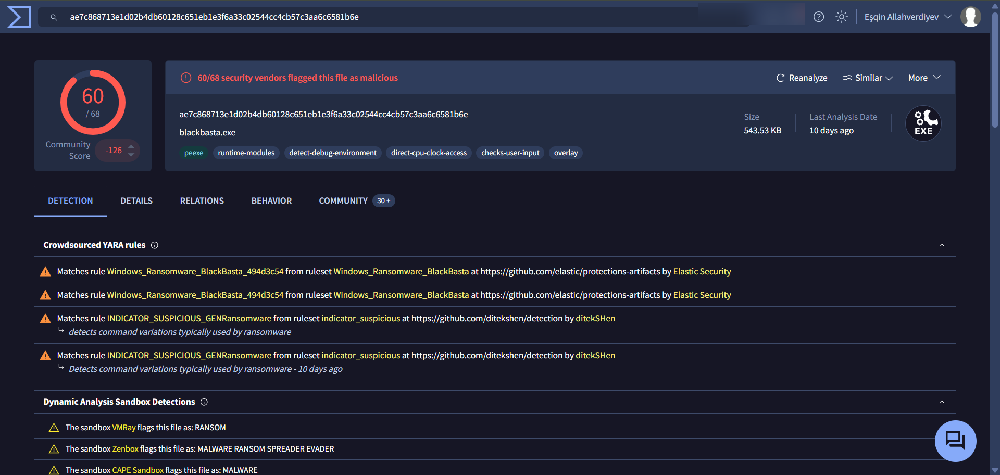
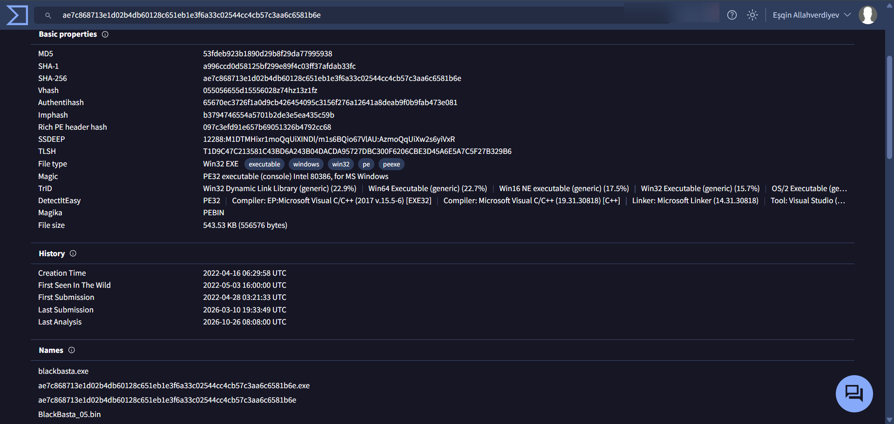
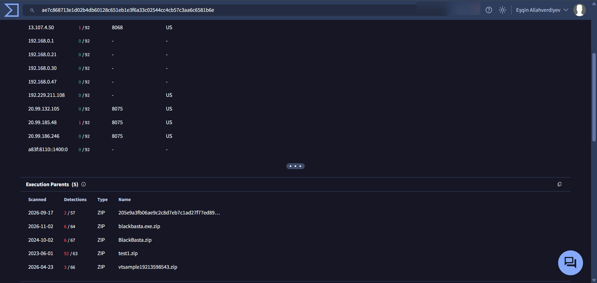
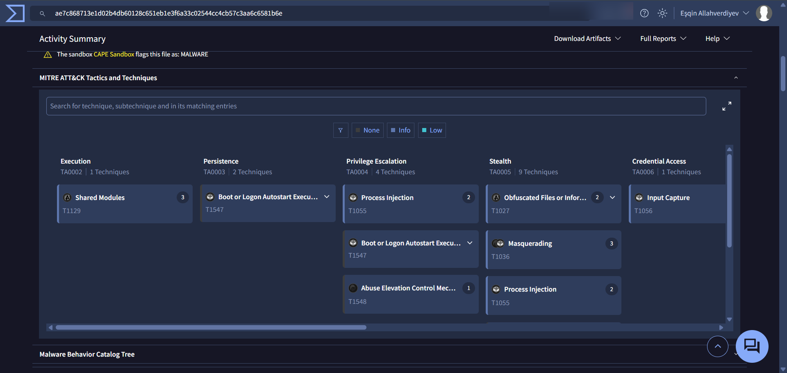
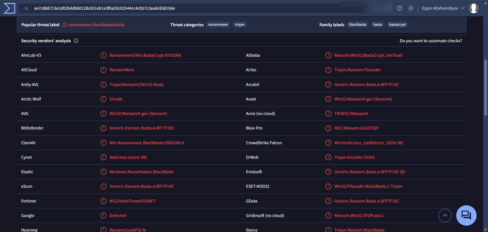

# 03 - Threat Intelligence Enrichment

Only the **hash** was submitted to VirusTotal, from the **host** machine - the sample itself was never uploaded and the VM stayed offline. (pestudio's own VirusTotal check shows *offline* in the VM.)

## 3.1 Detection ratio and community signals

 <b>Figure 35.</b> VirusTotal: 60/68 vendors flag the file as malicious; Elastic Security YARA rule Windows_Ransomware_BlackBasta matches; sandboxes VMRay, Zenbox and CAPE classify it as ransomware/malware.

| Item | Value |
|---|---|
| Detections | **60 / 68** |
| Community score | -126 |
| Behavior tags | peexe, runtime-modules, detect-debug-environment, direct-cpu-clock-access, checks-user-input, overlay |
| Crowdsourced YARA | `Windows_Ransomware_BlackBasta_494d3c54` (Elastic Security); `INDICATOR_SUSPICIOUS_GENRansomware` (ditekSHen) |
| Sandboxes | VMRay: RANSOM - Zenbox: MALWARE RANSOM SPREADER EVADER - CAPE: MALWARE |

## 3.2 File metadata

 <b>Figure 36.</b> VirusTotal Details: hashes (MD5/SHA-1/SHA-256, Imphash, Authentihash, SSDEEP, TLSH), file type and history.

| Field | Value |
|---|---|
| Imphash | `b3794746554a5701b2de3e5ea435c59b` (matches pestudio) |
| SSDEEP | `12288:M1DTMHixr1moQqUiXINDl/m1s6BQio67VlAU:AzmoQqUiXw2s6yiVxR` |
| Creation time | 2022-04-16 06:29:58 UTC (matches pestudio) |
| First seen in the wild | 2022-05-03 16:00:00 UTC |
| First submission | 2022-04-28 03:21:33 UTC |
| Known names | `blackbasta.exe`, `BlackBasta_05.bin`, SHA-256-named files |

The VirusTotal compiler stamp and imphash match our local findings, confirming we analyzed the same widely circulated sample.

## 3.3 Relations

 <b>Figure 37.</b> VirusTotal Relations: contacted IP addresses (sandbox) and execution parents (ZIP archives).

Sandbox-observed IPs include Microsoft/CDN ranges (e.g. `13.107.4.50`, `20.99.x.x`, `192.229.211.108`) and private addresses; these are **typical background traffic of analysis sandboxes** and are *not* treated as Black Basta infrastructure. Five ZIP archives are listed as execution parents (distribution/sharing containers).

## 3.4 MITRE ATT&CK view from the sandbox

 <b>Figure 38.</b> VirusTotal Activity Summary - ATT&CK matrix: Shared Modules, Boot/Logon Autostart, Process Injection, Obfuscated Files, Masquerading, Abuse Elevation Control, Input Capture ...

Sandbox-derived techniques include Execution (T1129), Persistence (T1547), Privilege Escalation (T1055, T1547, T1548), Stealth/Defense Evasion (T1027, T1036, T1055) and Credential Access (T1056). Several of these come from generic sandbox heuristics, so only techniques with direct evidence in our own static/dynamic work are carried into [05-mitre-attack-mapping.md](05-mitre-attack-mapping.md).

## 3.5 Antivirus family naming

 <b>Figure 39.</b> Security vendor verdicts: threat label ransomware.blackbasta/basta; family labels blackbasta, basta, bastacrypt.

Examples of vendor detections: `Win.Ransomware.BlackBasta` (ClamAV), `Windows.Ransomware.BlackBasta` (Elastic), `Win32/Filecoder.BlackBasta.C` (ESET), `Trojan-Ransom.BlackBasta` (Ikarus), `Ransomware/Win.BastaCrypt` (AhnLab), `Generic.Ransom.Basta.A` (BitDefender family). Consistent naming across vendors supports the **Black Basta** attribution at the *malware-family* level (not actor attribution).
