# 04 - Dynamic Analysis

> Execution happened **only** inside the isolated FLARE-VM (LAN segment, no internet) after reverting to the clean state. Telemetry tools were started *before* the sample.

## 4.1 Monitoring plan

| Telemetry | Tool |
|---|---|
| Registry & file-system delta | Regshot 1.9.1 x64 (1st shot / 2nd shot compare) |
| Real-time process / file / registry / network events | Process Monitor (Procmon) |
| Process tree and resource usage | Process Explorer |
| Simulated network services + PCAP | FakeNet-NG 3.5, Wireshark |

## 4.2 Baseline - Regshot 1st shot

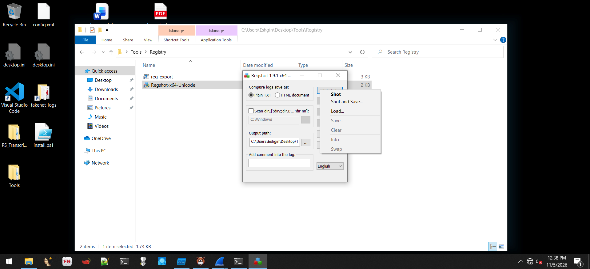 <b>Figure 34.</b> Regshot 1.9.1 x64 launched from the Tools\\Registry folder; "1st shot" menu.

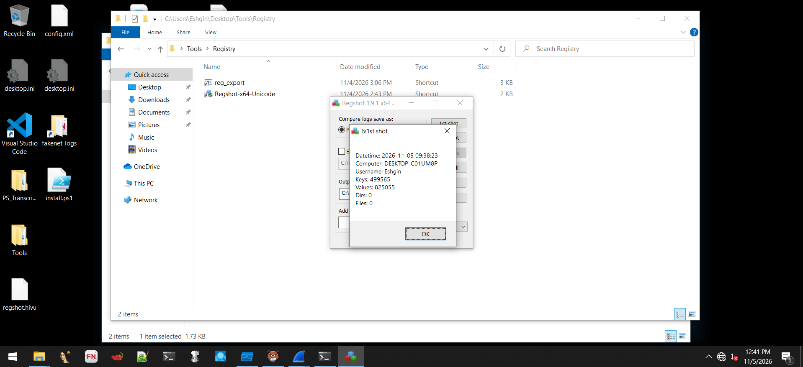 <b>Figure 40.</b> Regshot 1st shot summary: 499,565 keys, 825,055 values (before execution).

| | Keys | Values |
|---|---|---|
| 1st shot (pre-execution) | 499,565 | 825,055 |

## 4.3 Process Monitor configuration

Procmon was set to use a **backing file** (`C:\Logs\procmonlogs.pml`) instead of virtual memory because ransomware generates millions of events.

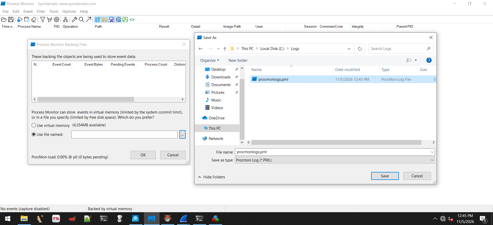 <b>Figure 41.</b> Procmon backing-file dialog and Save As to C:\\Logs\\procmonlogs.pml.

Filters (all **Include**): `Process Name is BlackBasta.exe`, plus operations `RegSetValue`, `RegCreateKey`, `Process Create`, `WriteFile`, `UDP Send`, `UDP Connect`, `TCP Send`, and `SetRenameInformationFile` (being added in the screenshot).

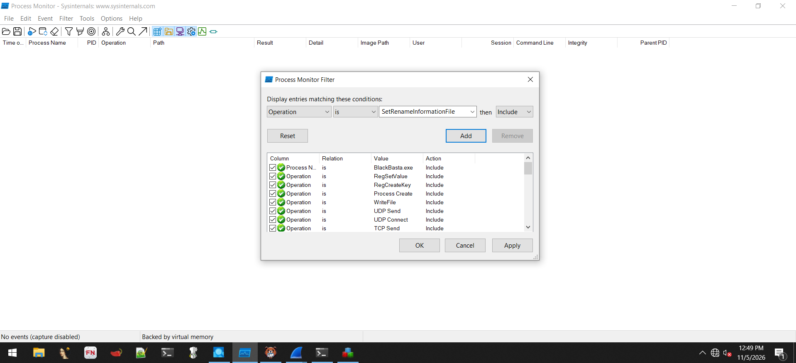 <b>Figure 42.</b> Process Monitor Filter dialog with the include rules for BlackBasta.exe.

## 4.4 Network simulation - FakeNet-NG

FakeNet-NG 3.5 was started from an elevated command prompt. It loaded `default.ini`, began capturing to a timestamped PCAP via Diverter, set a gateway on `Ethernet0`, and installed its own root certificate (`fakenet.flare`) so TLS interception works. Wireshark (two dumpcap instances) ran alongside.

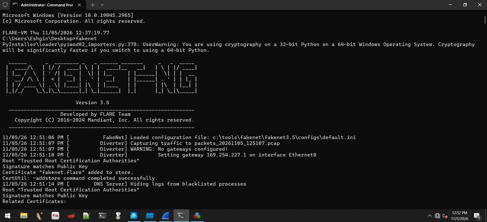 <b>Figure 45.</b> FakeNet-NG 3.5: configuration loaded, Diverter capturing traffic to a PCAP, DNS server started, fake root certificate installed.

## 4.5 Process tree

Process Explorer shows the monitoring tools and the sample running side by side. **`BlackBasta.exe` (PID 2024)** was started from the interactive desktop (**parent `explorer.exe`, PID 5152**) with *Medium* integrity (no elevation requested - consistent with the `asInvoker` manifest) and immediately drove CPU usage to ~93%.

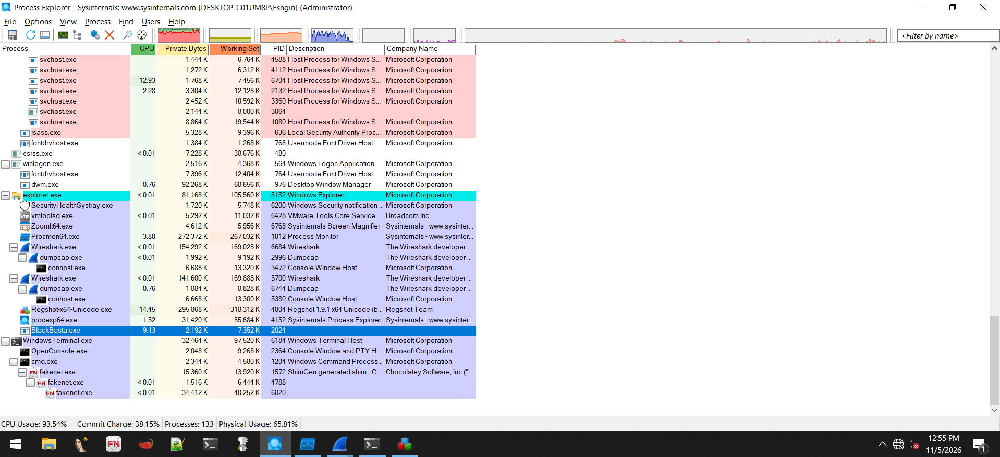 <b>Figure 48.</b> Process Explorer: BlackBasta.exe (PID 2024) under explorer.exe next to Procmon, Wireshark/dumpcap, Regshot and FakeNet-NG.

## 4.6 Procmon observations

First capture (`procmonlogs.pml`) - 4.83 million events total:

 <b>Figure 46.</b> Procmon: BlackBasta.exe spawns conhost.exe and cmd.exe, sets registry values, writes temp files, changes the wallpaper and drops readme.txt across directories.

| Time (VM) | Operation | Path / detail | Interpretation |
|---|---|---|---|
| 12:52:36 | `Process Create` | `C:\Windows\System32\Conhost.exe` | console host for the child shell |
| 12:52:36 | `Process Create` | `C:\Windows\SysWOW64\cmd.exe` (x2) | command execution (32-bit cmd on 64-bit OS) |
| 12:52:36 | `RegSetValue` | `HKLM\System\CurrentControlSet\Servic...` (REG_BINARY) | service-key modification (value details truncated in screenshot) |
| 12:52:37 | `WriteFile` | `C:\Users\<user>\AppData\Local\Temp\...` | temporary artifacts |
| 12:52:37 | `RegSetValue` | `HKCU\Control Panel\Desktop\Wallpaper` (REG_SZ) | wallpaper changed to ransom message |
| 12:52:37 | `RegCreateKey` | `HKCR\.basta\DefaultIcon` -> NAME NOT FOUND | tries to define icon for the `.basta` extension |
| 12:52:37 | `RegCreateKey` | `HKCR\.basta` -> ACCESS DENIED | file-association creation blocked (non-elevated) |
| 12:52:37 -> | `WriteFile` | `<dir>\readme.txt` (Offset 0, Length 40x) | **ransom note dropped in every directory** (e.g. `C:\Logs`, `C:\ProgramData`, `C:\Tools\...`, `C:\Users\Public\Documents`) |

> The `HKCR\.basta` creation failed with **ACCESS DENIED** because the sample ran at Medium integrity. With administrative rights it would be able to register the extension and icon.

A second, longer capture (`procmonlogs-2.pml`) grew to **22.1 million events** (39% shown after filtering) as encryption progressed:

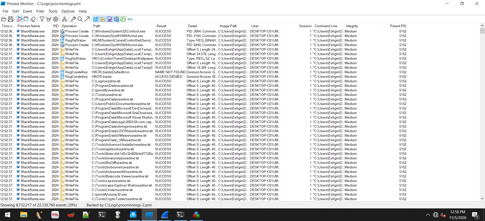 <b>Figure 50.</b> Second Procmon capture (procmonlogs-2.pml): 22.1 million events - same activity pattern at much larger volume.

## 4.7 File encryption evidence

Files in the toolkit directory (here, a scripts folder under `C:\Tools`) were all **renamed to `<original name>.basta`**; Windows Explorer classifies them as **"BASTA File"**, all with the same modification time (12:52 PM) - i.e. the encryption started seconds after execution. Procmon on the left shows continuous `WriteFile` operations into the same tree (e.g. `C:\Tools\idr\...`).

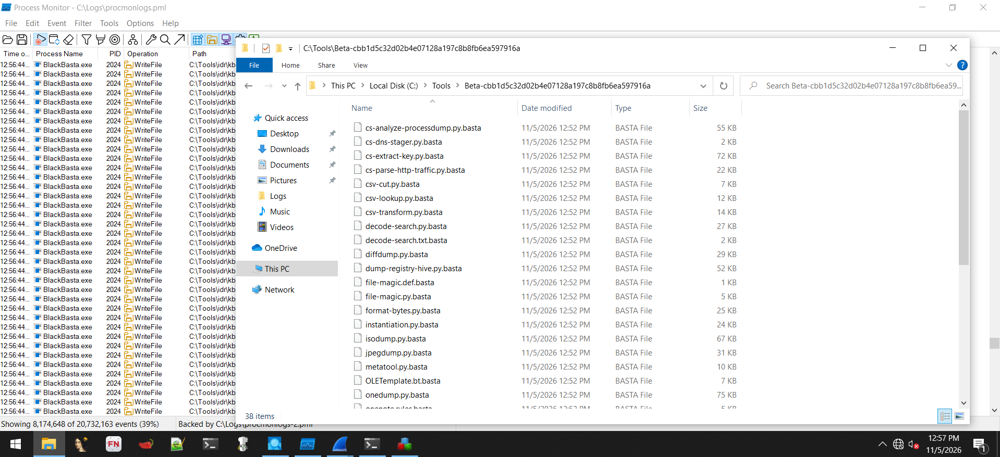 <b>Figure 49.</b> Encrypted files with the .basta extension (type "BASTA File") while Procmon streams WriteFile events.

Observed behavior:

- Original file names preserved, **`.basta` appended**.
- **System and tool directories** were also encrypted (not only user documents) - including the analyst's own toolkit.
- Directories visited include `C:\Logs`, `C:\ProgramData\...`, `C:\Tools\...`, `C:\Users\Public\Documents`.

## 4.8 Ransom note

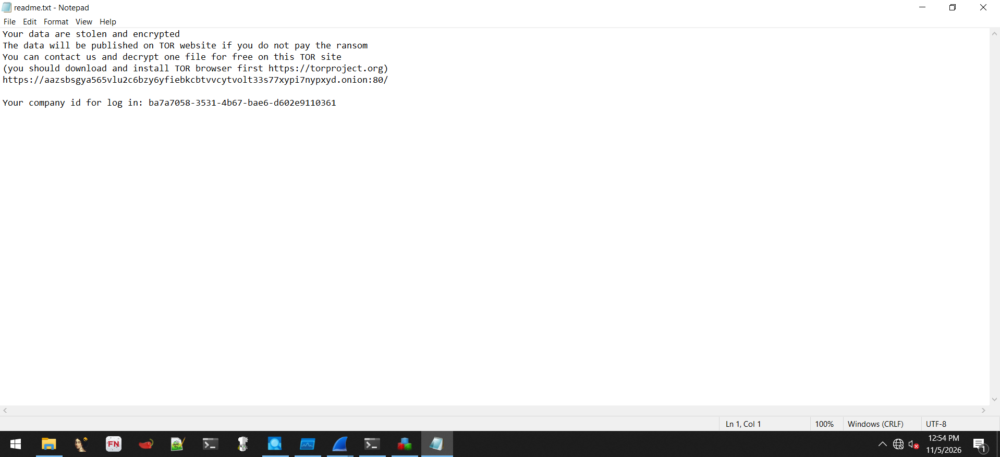 <b>Figure 47.</b> readme.txt - the ransom note dropped in each directory.

The note states that data are "stolen and encrypted", threatens publication on a **TOR leak site**, offers to decrypt **one file for free** and gives a **TOR onion link** plus a unique **company ID** for login. (Both values appear in the screenshot and are listed in [06-iocs.md](06-iocs.md).) The wording matches the string found statically (421 bytes) - **static -> dynamic correlation confirmed**.

## 4.9 Desktop impact and registry delta

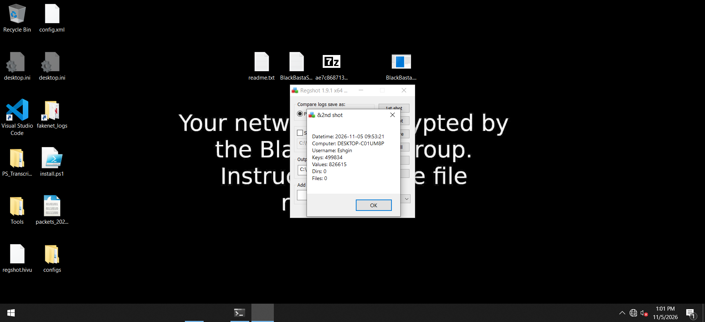 <b>Figure 51.</b> Regshot 2nd shot (after execution): 499,834 keys, 826,615 values. The ransom wallpaper is already visible behind the dialog.

| | Keys | Values |
|---|---|---|
| 1st shot | 499,565 | 825,055 |
| 2nd shot | 499,834 | 826,615 |
| **Delta** | **+269** | **+1,560** |

The registry delta includes normal Windows churn *and* the malware's changes; the authoritative malware-specific registry artifacts are those confirmed in Procmon (Wallpaper value, `.basta` key attempts, service-key write).

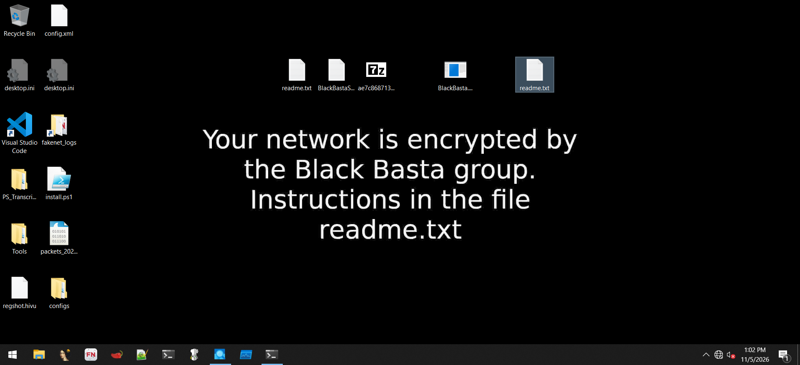 <b>Figure 52.</b> Desktop after execution: wallpaper reads "Your network is encrypted by the Black Basta group. Instructions in the file readme.txt". readme.txt icons appear on the desktop.

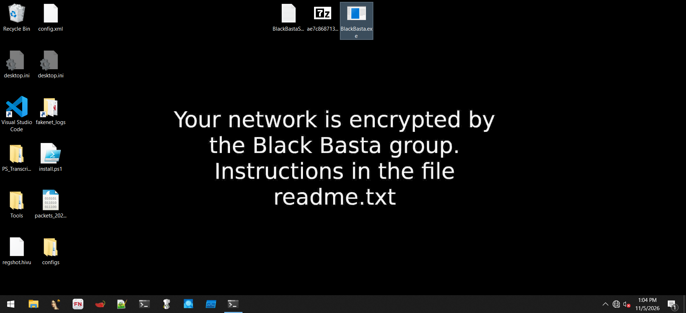 <b>Figure 53.</b> Later state of the desktop (13:04 VM time) with the ransom wallpaper still applied; the lab was then reverted to the FLARE CLEAN snapshot.

## 4.10 Dynamic analysis conclusions

1. Execution is **fast, noisy and multi-threaded** (~93% CPU, millions of file events).
2. The sample **does not require admin rights** to encrypt user-writable data, but several actions (`HKCR` writes, shadow-copy deletion) need elevation.
3. **Ransom-note and wallpaper artifacts** are reliable detection points.
4. Strings, capa and runtime behavior are consistent: static predictions (readme.txt, shadow copies, file renaming, registry) were validated dynamically.
5. Network behavior beyond the ransom note could not be observed (offline lab); FakeNet-NG captured the traffic attempts to a PCAP for review.
